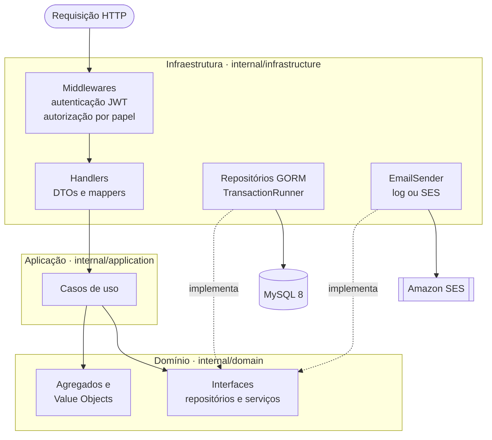
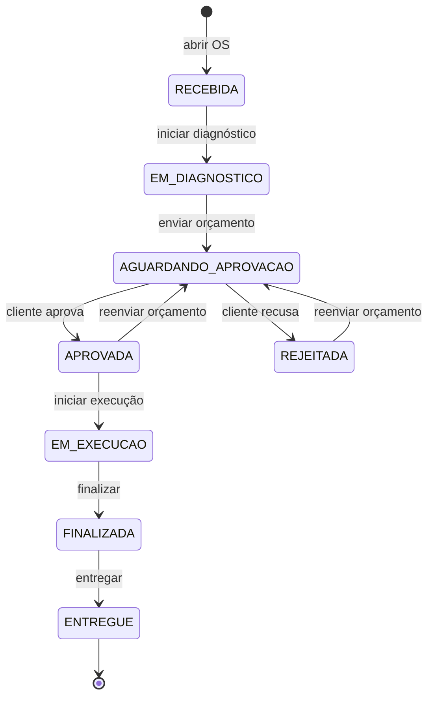
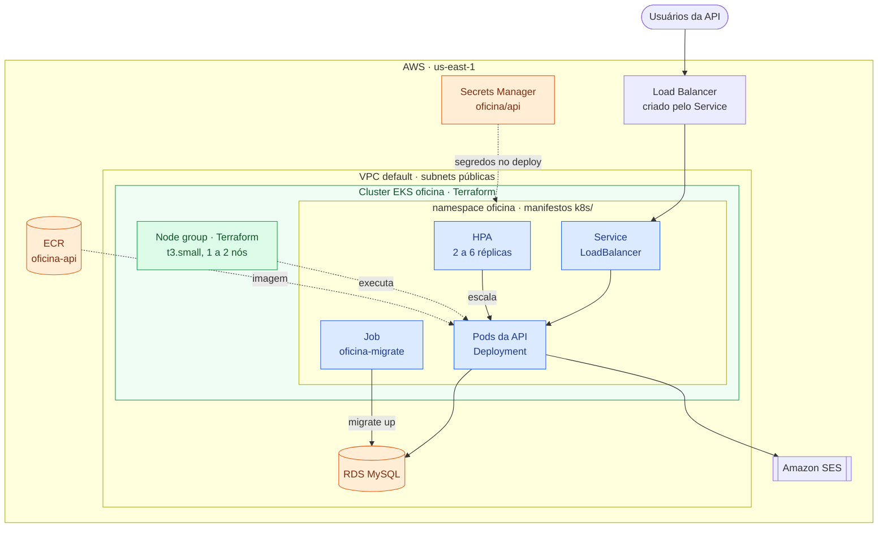
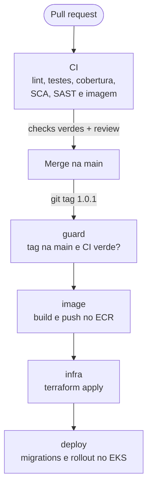

# Sistema de Oficina Mecânica: Tech Challenge Fase 2

[](https://github.com/muriloperosa/soat-architecture/actions/workflows/ci.yml)
[](https://github.com/muriloperosa/soat-architecture/actions/workflows/cd.yml)

API de gestão de ordens de serviço de uma oficina mecânica, cobrindo o fluxo completo desde o cadastro do cliente e do veículo até a execução do serviço, passando por diagnóstico, orçamento, aprovação, reserva de peças e entrega. Back-end em Go, com Gin, GORM e MySQL 8.

Na Fase 2 a aplicação passou a rodar em Kubernetes, no Minikube para desenvolvimento e no Amazon EKS na nuvem, com o deploy feito pelo GitHub Actions.

> [!IMPORTANT]
> **Vídeo demonstrativo:** _link a publicar_ (YouTube ou Vimeo, até 15 minutos).

## Objetivos da Fase 2

O sistema da Fase 1 já atendia a oficina, mas com mais demanda e a abertura de novas unidades ele precisa aguentar horários de pico e não pode depender de deploy manual. Nesta fase trabalhamos em:

- infraestrutura que escala, para diminuir o risco de o sistema ficar fora do ar;
- provisionamento e deploy automatizados;
- código mais organizado e com testes, para facilitar a evolução;
- escala automática da API quando o volume de ordens de serviço aumenta.

Onde encontrar cada requisito da fase no repositório:

| Requisito | Onde está |
| --- | --- |
| Clean Code, Clean Architecture e testes automatizados | Camadas em `internal/`, regra de dependência verificada em `test/architecture/`, testes unitários e de integração ([Qualidade](#qualidade)) |
| Abertura, consulta de status e listagem priorizada de OS | `/v1/ordens-servico` ([APIs](#apis)) |
| Aprovação ou recusa do orçamento pelo cliente | `/v1/ordens-servico/{id}/orcamento/aprovar` e `/rejeitar` |
| Aviso de mudança de status por e-mail | Notificações via Amazon SES ([Componentes](#componentes-da-aplicação)) |
| Dockerfile e docker-compose | [`Dockerfile`](Dockerfile), [`compose.yml`](compose.yml) |
| Deployments, Services, ConfigMaps, Secrets e HPA | [`k8s/`](k8s/) |
| Terraform do cluster Kubernetes | [`infra/`](infra/) |
| Banco de dados na nuvem | RDS MySQL, criado seguindo [`docs/AWS_SETUP.md`](docs/AWS_SETUP.md) |
| Pipeline de CI/CD | [`.github/workflows/`](.github/workflows/) |

## Stack

| Camada | Tecnologia |
| --- | --- |
| Linguagem e HTTP | Go 1.26, Gin |
| Persistência | MySQL 8, GORM, `golang-migrate` |
| Autenticação | JWT HS256 com access e refresh token |
| E-mail | Amazon SES (AWS SDK for Go v2), com provedor `log` para desenvolvimento |
| Documentação da API | Swagger gerado com `swaggo`, collections Postman |
| Contêiner | Docker multi-stage (`golang:1.26-alpine` → `alpine`, usuário sem privilégio) e Docker Compose |
| Orquestração | Kubernetes com Kustomize: Minikube e Amazon EKS |
| Infraestrutura como código | Terraform 1.5+ com o provider AWS 5.x |
| CI/CD | GitHub Actions, com autenticação na AWS por OIDC |
| Registry | Amazon ECR, com tags imutáveis |
| Testes e análise | `testify`, `mockery`, `testcontainers`, k6, `govulncheck`, `gosec`, OWASP ZAP, SonarQube |

## Arquitetura

### Componentes da aplicação

O projeto segue Clean Architecture com núcleo tático de DDD, num único deployável.



Domínio (entidades e value objects), aplicação (casos de uso) e infraestrutura (adaptadores HTTP, de persistência e de e-mail, frameworks) são pacotes separados, e as dependências apontam só para dentro: infraestrutura conhece aplicação e domínio, aplicação conhece só domínio, e domínio não conhece nada do projeto. Os repositórios e serviços externos que o domínio usa são interfaces declaradas nele e implementadas na infraestrutura. Essa regra é verificada por um teste automático (`test/architecture/`). Cada agregado (ordem de serviço, cliente, veículo, peça, usuário) carrega suas próprias regras de negócio em Value Objects auto validáveis, como `Documento`, `Placa` e `Status`, que nascem válidos ou não nascem.

A persistência usa GORM, mas de forma isolada: os models do GORM nunca vazam para a camada de domínio, existe um mapeamento explícito entre entidade e model na fronteira do repositório. Autenticação é feita via JWT, com um middleware que reavalida se o usuário segue ativo a cada requisição, não só no login, e um segundo middleware que autoriza por tipo e papel de usuário. Situações que exigem consistência entre agregados diferentes, como reservar peça e verificar estoque, passam por um `TransactionRunner` que garante atomicidade e usa `SELECT ... FOR UPDATE` para serializar concorrência.

Cada mudança de status da ordem de serviço dispara um e-mail ao cliente depois que a transição já foi persistida. Se o envio falhar, o erro fica no log e o status não é desfeito. No envio do orçamento vai um segundo e-mail, com serviços, peças, quantidades e valores. Localmente o provedor padrão é `log` (`EMAIL_PROVIDER`), que só registra a mensagem e não precisa de AWS. Com `ses`, a aplicação envia pelo Amazon SES e não sobe sem `SES_FROM_ADDRESS`. No AWS Academy o SES fica em sandbox e só entrega para endereços verificados.

O versionamento do schema do banco é feito com `golang-migrate`, migrations em `migrations/mysql/`. As decisões estruturais do projeto estão registradas como ADRs em [`docs/adr/`](docs/adr/), e o detalhamento das convenções internas está em [`docs/ARQUITETURA.md`](docs/ARQUITETURA.md).

### Ciclo de vida da ordem de serviço

As transições de status são regras do domínio (`StatusOrdemServico.PermiteTransicaoPara`), e qualquer outra é recusada pela API.



Quando o cliente aprova o orçamento, as peças ficam reservadas, e a baixa no estoque só acontece na finalização. A listagem de ordens de serviço segue a ordem de prioridade da oficina: em execução, aprovadas, aguardando aprovação ou rejeitadas, em diagnóstico e recebidas, das mais antigas para as mais novas. As finalizadas e entregues saem da listagem, mas continuam disponíveis na consulta por id ou por número.

### Infraestrutura provisionada

Na AWS, a aplicação fica organizada assim. Em verde está o que o Terraform cria, em laranja o que é preparado uma vez por conta seguindo [`docs/AWS_SETUP.md`](docs/AWS_SETUP.md), e em azul o que os manifestos de [`k8s/`](k8s/) criam a cada deploy.



| Recurso | Como é criado |
| --- | --- |
| Cluster EKS e node group | Terraform em [`infra/`](infra/), usando a `LabRole`, a VPC default e as subnets públicas que já existem na conta do AWS Academy |
| Deployment, Service, HPA, ConfigMap, Secret e Job de migration | Manifestos de [`k8s/`](k8s/), aplicados pelo deploy |
| Load Balancer | Criado pela AWS a partir do Service `LoadBalancer` do overlay EKS |
| RDS MySQL, repositório ECR e secret `oficina/api` | Uma vez por conta, seguindo [`docs/AWS_SETUP.md`](docs/AWS_SETUP.md) |

No Minikube roda o mesmo conjunto, mas com o MySQL dentro do cluster (StatefulSet) e o Service como `NodePort`. Mais detalhes sobre cada recurso em [`docs/KUBERNETES.md`](docs/KUBERNETES.md).

### Fluxo de deploy



A CI ([`ci.yml`](.github/workflows/ci.yml)) roda em todo PR e em todo push na `main`, e não tem acesso à AWS. O deploy ([`cd.yml`](.github/workflows/cd.yml)) só acontece quando alguém cria uma tag de versão, como `1.0.1`, num commit da `main` que passou na CI. O workflow se autentica na AWS via OIDC, então não existe chave de acesso salva no GitHub.

Antes de atualizar a API, o deploy roda as migrations num Job ([ADR 0006](docs/adr/0006-migrations-em-job-kubernetes.md)). Se a migration falhar, a versão anterior continua no ar. O passo a passo, as credenciais, o rollback e os custos estão em [`docs/CI_CD.md`](docs/CI_CD.md).

## APIs

A documentação da API é gerada com Swagger a partir das anotações dos handlers e fica em [`docs/swagger/`](docs/swagger/). Com a aplicação rodando, a UI abre em `/swagger/index.html` e faz as chamadas para o mesmo endereço em que foi aberta, seja localhost, Minikube ou EKS.

Também deixamos duas collections do Postman em [`.dev/postman/`](.dev/postman/):

- `soat-architecture.postman_collection.json`, com todos os endpoints;
- `soat-demo-fluxo-completo.postman_collection.json`, que percorre o fluxo da OS do login até a entrega e pode ser executada inteira no Collection Runner.

A variável `base_url` aponta para o EKS. Para testar localmente, use o valor de `local_url` (`http://localhost:8080`).

## Executar localmente

Pré-requisitos: Docker e Docker Compose.

Sobe o ambiente inteiro com um único comando, sem exigir Go instalado localmente:

```bash
chmod +x .dev/scripts/setup.sh
.dev/scripts/setup.sh
```

- limpa containers e volumes de execuções anteriores
- builda as imagens da aplicação e do toolbox
- sobe o MySQL
- roda migrations, testes unitários e de integração
- popula o banco com usuários de login e dados fictícios
- sobe a API
- ao final, imprime as credenciais dos usuários seedados (admin, atendente, mecânico, cliente) para testar a API

A API fica em `http://localhost:8080` e o Swagger em `http://localhost:8080/swagger/index.html`.

## Provisionar a infraestrutura com Terraform

O Terraform fica em [`infra/`](infra/) e cria o cluster EKS e um node group na conta do AWS Academy. Como a Academy não deixa criar roles IAM, o cluster usa a `LabRole` e aproveita a VPC default e as subnets públicas que já existem na conta. Também não criamos NAT Gateway, que seria cobrado mesmo com o cluster parado.

Pré-requisitos: Terraform 1.5 ou mais novo, AWS CLI e `kubectl`.

**1. Exportar as credenciais do Learner Lab.** Elas expiram junto com a sessão, então pegue as atuais em **AWS Details**, no console do lab. Não salve esses valores no repositório.

```bash
export AWS_ACCESS_KEY_ID=...
export AWS_SECRET_ACCESS_KEY=...
export AWS_SESSION_TOKEN=...
export AWS_DEFAULT_REGION=us-east-1
```

**2. Criar o cluster.** Dentro de `infra/`:

```bash
terraform init
terraform plan
terraform apply
```

**3. Apontar o `kubectl` para o cluster.** O comando sai pronto no output `update_kubeconfig`:

```bash
aws eks update-kubeconfig --region us-east-1 --name oficina
```

**4. Destruir no fim da sessão.** O control plane é cobrado por hora enquanto existir, inclusive depois que a sessão do lab acaba:

```bash
terraform destroy
```

As variáveis (nome do cluster, versão do Kubernetes, tipo e quantidade de nós, VPC e subnets) estão explicadas em [`infra/README.md`](infra/README.md).

## Deploy em Kubernetes

Os manifestos ficam em [`k8s/`](k8s/), organizados com Kustomize: uma base comum (Deployment, Service, ConfigMap e HPA da API) e overlays para Minikube e EKS. As migrations rodam num Job separado ([ADR 0006](docs/adr/0006-migrations-em-job-kubernetes.md)).

### Minikube: subir e demonstrar o autoscaling

Pré-requisitos: Docker rodando, Minikube, `kubectl`, k6, Go 1.26 e `make`. Versões mínimas e recursos de máquina estão em [`docs/KUBERNETES.md`](docs/KUBERNETES.md#requisitos-da-máquina).

**1. Criar o cluster.** Só na primeira vez ou depois de um `minikube delete`. Se ele só estava parado, basta `minikube start`.

```bash
minikube start --cpus=4 --memory=6g --disk-size=20g
minikube addons enable metrics-server
```

**2. Criar o arquivo de segredos.** Ele não vai para o git. Troque os dois `changeme`; a `DB_PASSWORD` deve ter só letras e números.

```bash
cp k8s/overlays/minikube/secrets.env.example k8s/overlays/minikube/secrets.env
```

**3. Construir a imagem e fazer o deploy.** O `k8s-deploy` aplica a configuração, roda as migrations num Job e sobe a API.

```bash
make k8s-build
make k8s-deploy
make k8s-status    # 2 pods da API em Running e o HPA com cpu: X%/70%
```

**4. Popular o banco.** Só quando o banco está vazio. Num terminal, abra o túnel até o MySQL e deixe rodando:

```bash
kubectl --context minikube -n oficina port-forward pod/oficina-mysql-0 3307:3306
```

Em outro terminal, rode o seed com os valores do `secrets.env`. Ele cria o usuário `admin@oficina.com` com a senha `Senha@123`:

```bash
DB_HOST=127.0.0.1 DB_PORT=3307 DB_USER=root DB_NAME=mecanica \
DB_PASSWORD=<valor do secrets.env> JWT_SECRET=<valor do secrets.env> \
go run ./cmd/seed
```

Depois feche o túnel.

**5. Obter a URL da API.** No macOS (driver Docker) o comando abre um túnel e precisa ficar rodando num terminal próprio. Anote a URL impressa.

```bash
make k8s-url
```

**6. Abrir o monitoramento**, um comando por terminal:

```bash
kubectl --context minikube -n oficina get hpa oficina-api -w
kubectl --context minikube -n oficina get pods -l app.kubernetes.io/name=oficina-api -w
watch -n 5 kubectl --context minikube -n oficina top pods    # no macOS: brew install watch
```

**7. Rodar o teste de carga.** São 4 minutos, em rampa até 100 usuários virtuais.

```bash
make load-test BASE_URL=<url do passo 5> K6_EMAIL=admin@oficina.com K6_SENHA=Senha@123
```

**8. Acompanhar a escala.** Cerca de um minuto depois do início a CPU passa da meta de 70% e o HPA sobe as réplicas de uma em uma, até 4 ou 5. Depois que o k6 termina, o número volta para 2 em mais ou menos um minuto e meio. As métricas do Minikube atualizam a cada 60 segundos, então a coluna `TARGETS` muda aos saltos. O motivo de cada decisão aparece em:

```bash
kubectl --context minikube -n oficina describe hpa oficina-api | grep SuccessfulRescale
```

**9. Encerrar.** `minikube stop` desliga o cluster e mantém tudo. `make k8s-delete` apaga o namespace, inclusive os dados do MySQL.

A explicação de cada recurso, a referência de comandos `kubectl` e a solução dos problemas mais comuns (HPA em `<unknown>`, pod que não fica pronto, migration com erro) estão em [`docs/KUBERNETES.md`](docs/KUBERNETES.md).

### EKS

Pré-requisitos: o cluster criado pelo [Terraform](#provisionar-a-infraestrutura-com-terraform) e a conta da AWS preparada seguindo [`docs/AWS_SETUP.md`](docs/AWS_SETUP.md). Isso só precisa ser feito uma vez e cria o RDS, o repositório no ECR, o secret `oficina/api` e a role que o GitHub Actions usa para fazer o deploy.

**1. Lançar uma versão.** Basta criar uma tag de versão num commit da `main`. Isso dispara o [`cd.yml`](.github/workflows/cd.yml), que confere se a CI do commit passou, publica a imagem no ECR, roda as migrations e atualiza a API.

```bash
git switch main
git pull
git tag 1.0.1
git push origin 1.0.1
```

**2. Acompanhar o deploy** em **Actions → CD (Continuous Deployment)**. No fim do run, o resumo mostra a versão, a imagem e a URL da API. Também dá para pegar a URL direto no cluster:

```bash
kubectl -n oficina get svc oficina-api -o jsonpath='{.status.loadBalancer.ingress[0].hostname}'
```

**3. Conferir** com `curl http://<url>/v1/health/ready`. O Swagger fica em `http://<url>/swagger/index.html`.

O HPA precisa do `metrics-server`, que não vem instalado no EKS. Sem ele, as metas do HPA ficam em `<unknown>`. Rollback, credenciais e o deploy manual com `make k8s-deploy K8S_OVERLAY=eks` estão em [`docs/CI_CD.md`](docs/CI_CD.md#parte-2-deploy) e [`docs/KUBERNETES.md`](docs/KUBERNETES.md#eks).

## Qualidade

O projeto mantém uma meta de cobertura de 80% ou mais nos domínios críticos, com testes unitários isolados por camada via mocks (`mockery`) e testes de integração que sobem um MySQL real com `testcontainers`, aplicam as migrations de produção e batem no router completo da aplicação, sem nenhum tipo de mock. `make lint` roda `go vet` e as regras estáticas do projeto antes de qualquer commit ser aceito.

A análise de vulnerabilidades cobre três frentes independentes: `govulncheck` para dependências conhecidas (SCA), `gosec` para padrões de risco no código fonte (SAST) e OWASP ZAP para ataques simulados contra a API em execução (DAST), este último rodando autenticado uma vez por papel de usuário para provar que o controle de acesso bloqueia de fato quem não tem permissão. SonarQube fica disponível localmente para análise estática complementar. Todos os detalhes e a justificativa de cada ferramenta estão em [`docs/SECURITY.md`](docs/SECURITY.md).

Um hook de `pre-push` local, instalado via `make hooks-install`, roda mocks, lint, testes e geração do Swagger antes de liberar qualquer push, evitando que código desatualizado ou quebrado chegue ao repositório remoto.

## Documentação

- [Guia de desenvolvimento](docs/DEVELOPMENT_GUIDE.md): pacote completo das informações necessárias para o desenvolvimento do projeto, serve como guia para os desenvolvedores
- [Arquitetura](docs/ARQUITETURA.md): convenções internas de camadas, mapeamento e injeção de dependência
- [ADRs](docs/adr/): decisões estruturais registradas e justificadas
- [Modelo de domínio](docs/DOMAIN_MODEL.md): agregados, entidades e Value Objects
- [Banco de dados](docs/database/DATABASE.md): modelo relacional e diagrama
- [Segurança](docs/SECURITY.md): ferramentas de SCA, SAST e DAST usadas e a justificativa de cada uma
- [Kubernetes](docs/KUBERNETES.md): manifestos em `k8s/`, requisitos da máquina, deploy no Minikube, comandos `kubectl` e demonstração do autoscaling
- [Infraestrutura AWS](infra/README.md): Terraform do cluster EKS no Learner Lab, com credenciais, apply e destroy
- [Preparação da conta AWS](docs/AWS_SETUP.md): RDS, ECR, secret da aplicação e role de deploy, uma vez por conta
- [CI/CD](docs/CI_CD.md): CI em GitHub Actions (testes, cobertura, segurança) e deploy no EKS por tag, com diagramas de cada etapa, credenciais e rollback
- [Swagger](docs/swagger/): documentação da API gerada a partir dos handlers
- [Collections Postman](.dev/postman/): todos os endpoints e o fluxo completo da demo
