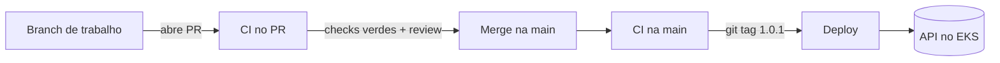
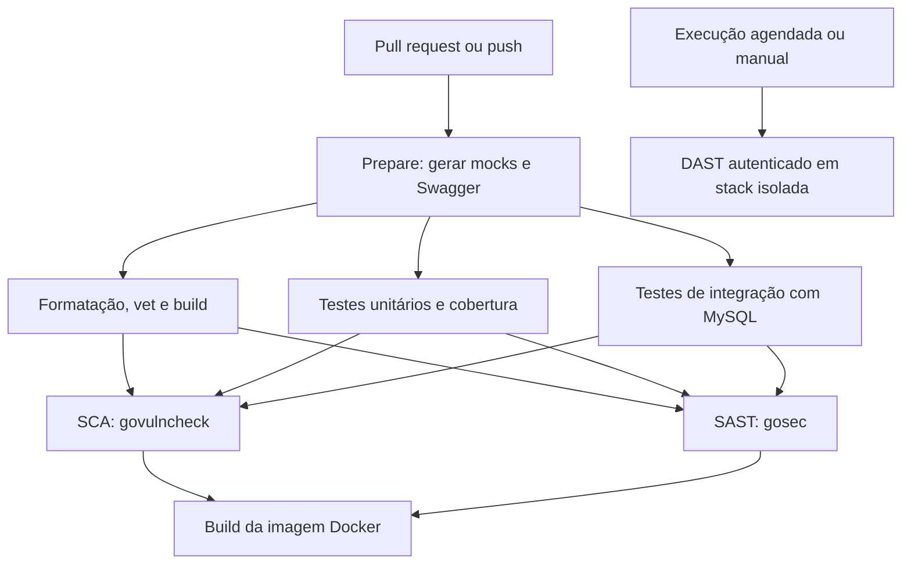
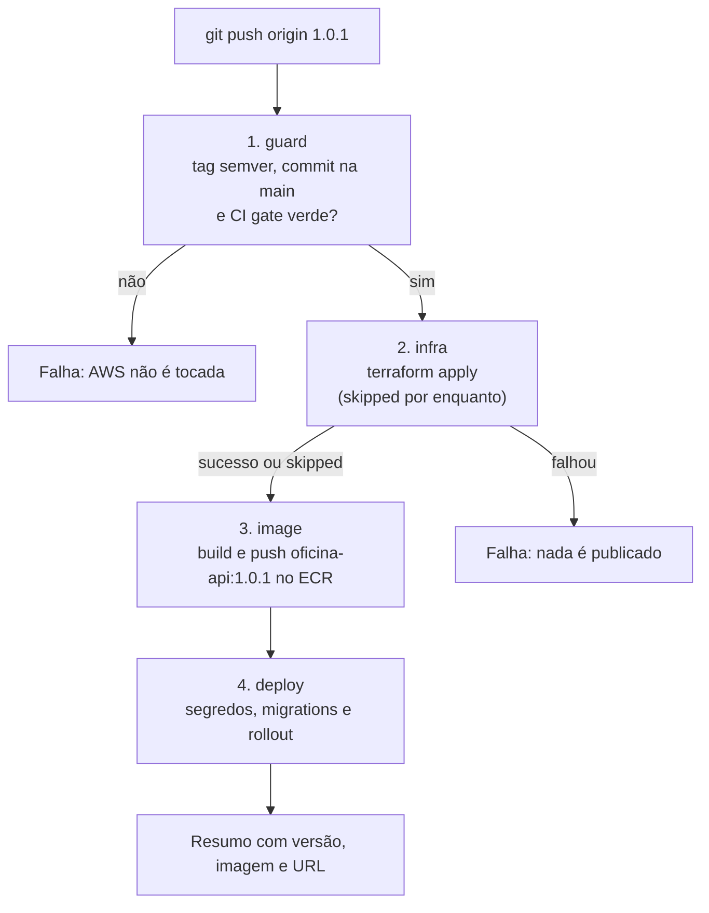
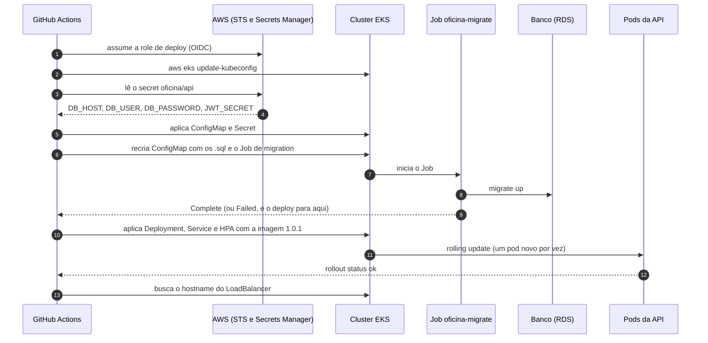
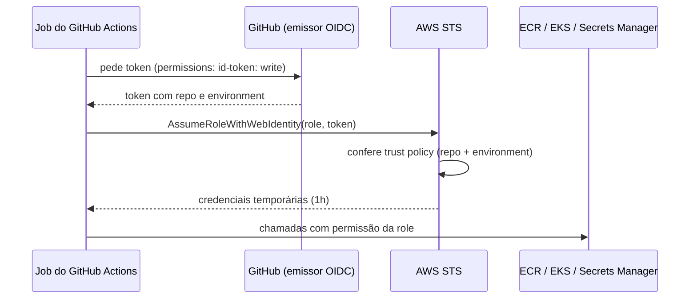

# CI/CD: como o código sai de um PR e chega ao EKS

Este documento explica os dois workflows de GitHub Actions do projeto:

- **CI** ([`.github/workflows/ci.yml`](../.github/workflows/ci.yml)): valida cada pull request e cada push na `main` com compilação, testes, cobertura e segurança.
- **CD** ([`.github/workflows/cd.yml`](../.github/workflows/cd.yml)): publica uma versão no cluster EKS quando alguém cria uma tag como `1.0.1` num commit da `main`. Antes de qualquer passo na AWS, ele confere que a CI daquele commit passou.

Se você só quer lançar uma versão, vá direto para [Como lançar uma versão](#como-lançar-uma-versão).

## Sumário

- [Visão geral](#visão-geral)
- [Parte 1: CI](#parte-1-ci)
- [Parte 2: Deploy](#parte-2-deploy)
- [Segurança dos workflows](#segurança-dos-workflows)
- [Decisões](#decisões)

## Visão geral

O caminho completo de uma mudança:



- A **CI** diz se o código está bom. Ela nunca publica nada e nunca recebe credenciais da AWS.
- O **Deploy** pega uma versão já aprovada na `main`, valida de novo e coloca no ar. Ele só acontece quando alguém cria uma tag: merge na `main` não faz deploy sozinho.

## Parte 1: CI

O objetivo da CI é validar alterações automaticamente antes do merge, reutilizando os comandos e ferramentas que já fazem parte do projeto: dar feedback rápido, executar as mesmas verificações do desenvolvimento local, testar migrations com MySQL real e não expor segredos a código não confiável.

### Fluxo da CI



Os jobs são divididos em quatro grupos sequenciais: **Prepare** gera mocks e Swagger; **Test & Validate** executa qualidade, testes unitários/cobertura e integração em paralelo; **Security** executa SCA e SAST em paralelo; **Docker Build** cria a imagem. Cada grupo depende do sucesso de todos os jobs do grupo anterior, por meio de `needs`, então uma falha interrompe os grupos seguintes.

Paralelismo reduz o tempo de espera, mas não reduz necessariamente o consumo de minutos: os minutos de todos os jobs continuam sendo somados. Para controlar uso/custo, limite execuções redundantes com `concurrency` (já configurado), mantenha jobs focados e curtos e use filtros de paths nos pushes. O workflow ignora `**/*.md` somente em pushes na `main`; PRs direcionados à `main` sempre executam para publicar os checks, inclusive quando alteram apenas Markdown. Isso evita que checks obrigatórios fiquem em estado pendente por o workflow não ter sido iniciado. Não execute testes simultaneamente duplicados: cobertura já roda os testes unitários e deve ser a mesma execução que alimenta o verificador de cobertura.

### Gatilhos

Automaticamente, o workflow principal executa em eventos relacionados à branch `main`:

- `pull_request` cujo destino seja a `main`;
- `push` na `main`, incluindo o commit criado pelo merge de um PR ou um push direto.

O evento `workflow_dispatch` também permite iniciar a CI manualmente pela aba **Actions**, útil para testes. Na execução manual, selecione a branch que deseja validar; o filtro de Markdown não se aplica à execução manual. Pushes em branches de trabalho e release não executam esta CI automaticamente; elas são validadas ao abrir ou atualizar um PR direcionado à `main`. O PR recebe os checks antes do merge, inclusive quando altera apenas Markdown, e o push resultante do merge dispara uma nova execução na `main`. Pushes na `main` que alterem apenas arquivos Markdown continuam ignorados pelo filtro de paths.

O `concurrency` usa um grupo por PR, com cancelamento: um push novo no PR cancela a execução anterior e evita consumir runners em commits superados. Pushes na `main` e execuções manuais usam um grupo por commit e nunca são cancelados, porque o CD exige o **CI gate** verde do commit da tag. Se a CI de um commit da `main` fosse cancelada por um merge seguinte, uma tag nesse commit não poderia ser publicada.

Não use `pull_request_target` para executar código do pull request. Esse evento pode conceder contexto privilegiado; para a CI comum, `pull_request` permite validar contribuições sem disponibilizar segredos do repositório a forks.

### Jobs

O workflow implementado separa as verificações em jobs paralelos: `quality`, `generated`, `unit`, `integration`, `sca` e `sast`. Isso permite que falhas rápidas de formatação/build apareçam sem aguardar os testes mais longos. O job `generated` executa as mesmas gerações de mocks e Swagger do hook local e falha se os arquivos gerados não estiverem commitados. Após qualidade e testes passarem, `image` constrói a imagem Docker sem publicar. O perfil de cobertura e os relatórios de segurança são processados no mesmo job que os gera, evitando upload/download entre jobs.

Cada job possui `timeout-minutes` para limitar consumo em execução travada. Todas as actions são fixadas por SHA completo, com a versão legível registrada em comentário: `checkout` v4.4.0, `setup-go` v5.0.2 e `upload-artifact` v7.0.2 na CI; `configure-aws-credentials` v6.3.0, `amazon-ecr-login` v2.1.7 e `setup-terraform` v4.0.1 no deploy. Os checkouts usam `persist-credentials: false`, pois nenhum job precisa enviar alterações de volta ao repositório.

#### Validação estática

Executada em runner Linux hospedado pelo GitHub:

1. Checkout do repositório.
2. Instalação da versão de Go indicada pelo `go.mod`, atualmente `1.26.10`.
3. Cache de dependências usando o `go.sum`.
4. Verificação de formatação (`gofmt -l`).
5. `go vet ./...`.
6. Validação de geração de mocks e Swagger em job próprio, com versões controladas dos geradores.

Para geração, gere os arquivos em um checkout limpo e falhe se `git diff --exit-code` encontrar alterações. Dessa forma, o pipeline acusa arquivos derivados desatualizados sem modificar o commit.

#### Testes unitários, cobertura e compilação

Execute:

```bash
go test ./... -cover
go build ./...
```

O alvo atual `make test` executa os testes unitários com cobertura. A compilação explícita continua útil porque deixa essa garantia visível como etapa própria.

O gate de cobertura é **mínimo de 80% por pacote elegível** nos pacotes de `internal/application`, `internal/domain` e `internal/infrastructure` que possam ser testados de forma significativa. O workflow usa `go-test-coverage` com configuração versionada em `.testcoverage.yml`. Além de mocks e código gerado, ficam fora do cálculo os executáveis em `cmd`, a documentação Swagger gerada, migrações e helpers de teste. Os arquivos `routes.go` permanecem no gate e têm testes de registro de rotas. O pacote de composição `wiring` e o pacote raiz de conexão/bootstrap MySQL também permanecem no gate; seus construtores são exercitados com dependências controladas. Os pacotes de repositório por domínio continuam sujeitos ao limite. Pacotes elegíveis abaixo de 80% fazem o job falhar e devem receber testes até alcançar a meta. Não há baseline temporário nem tolerância de regressão.

Na prática, a verificação gera um profile com `go test -coverprofile` e `go-test-coverage` compara cada pacote elegível contra 80%. O resumo do GitHub Actions mostra tanto a cobertura bruta do profile quanto a cobertura calculada no escopo do gate. Esses percentuais podem diferir porque a cobertura bruta inclui código excluído da política, como mocks, código gerado, executáveis, migrações e helpers de teste. O gate e sua meta por pacote também aparecem no resumo. O profile completo continua publicado como artefato para inspeção detalhada.

#### Testes de integração

O projeto já possui testes de integração com a build tag `integration`. O `TestMain` inicia um container MySQL 8 com Testcontainers, aplica as migrations reais e monta o router completo.

Comando:

```bash
go test -tags integration ./test/integration/... -v
```

Use um runner hospedado com Docker disponível. Não é necessário iniciar um serviço MySQL adicional no workflow: o próprio Testcontainers gerencia o banco de teste. Não passe `.env` nem credenciais de produção; as configurações usadas no teste são efêmeras.

#### Build da imagem Docker

Depois de passarem qualidade, testes unitários/cobertura e integração, o job `image` executa `docker build` usando o Dockerfile do projeto. Na CI a imagem é construída apenas no runner e não é enviada a um registry; a publicação no ECR acontece no workflow de deploy.

#### SCA: vulnerabilidades em dependências

Execute `govulncheck` em job separado, com uma versão explícita e controlada da ferramenta. O comando local documentado é:

```bash
govulncheck -json ./... > govulncheck.json
go run ./.github/scripts/check_security.go govulncheck govulncheck.json
```

O gate bloqueia **qualquer vulnerabilidade alcançável**: no stream JSON do `govulncheck`, um evento `finding` com `trace[0].function` preenchida indica que uma função vulnerável foi chamada. Achados apenas no nível de módulo ou pacote, sem função na trace, permanecem no relatório sem bloquear. A política não depende da severidade OSV, que não é preenchida de forma confiável para todos os registros. `.github/scripts/check_security.go` interpreta o formato JSON emitido pela versão fixada da ferramenta. O relatório é publicado como artefato de sete dias.

#### SAST: análise estática de segurança

Execute `gosec` em job separado, também com versão controlada. O comando local gera um relatório em JSON:

```bash
gosec -fmt=json -out=security/reports/gosec.json ./...
```

O workflow executa o scanner diretamente, sem depender do `make sec-sast` que ainda contém `|| true`. Essa opção mascara o código de saída do scanner no alvo local e deve ser corrigida antes de reutilizá-lo como gate. `.github/scripts/check_security.go` aplica o bloqueio a achados **críticos ou altos com alta confiança**. O relatório é publicado como artefato de sete dias. Falsos positivos devem ser tratados por exclusões justificadas e revisáveis, não ignorando qualquer erro do comando.

#### Política de bloqueio e exceções SCA/SAST

Um achado bloqueante impede o merge até que seja corrigido ou aceite formalmente como exceção. A exceção deve:

- identificar a regra/CVE e os arquivos ou dependências afetados;
- explicar por que o achado não é explorável, é falso positivo ou será aceito temporariamente;
- registrar responsável e data de expiração/revisão;
- ser armazenada em configuração versionada, revisada junto com o código;
- ser removida quando a correção ou atualização da dependência for concluída.

Não criar supressões sem prazo ou justificativa. A política bloqueia qualquer SCA alcançável e SAST crítico/alto com alta confiança. Achados SCA sem função alcançável e demais severidades SAST continuam visíveis para priorização. Mudanças na política ou em exclusões devem passar por revisão de código.

#### DAST: OWASP ZAP

O DAST não precisa bloquear todo pull request no primeiro estágio. O script `security/zap-scan.sh` sobe uma stack isolada de aplicação e MySQL, semeia usuários e dados e executa scans autenticados por papel.

Política inicial:

- executar semanalmente em agenda e sob demanda (`workflow_dispatch`);
- considerar execução a cada merge na `main` quando o tempo e a estabilidade forem conhecidos;
- publicar relatórios como artefatos com retenção limitada;
- bloquear alertas críticos e altos confirmados;
- documentar falsos positivos com evidência, justificativa e referência no arquivo de regras do ZAP;
- revisar o tratamento atual de falhas antes de torná-lo gate, pois o script continua mesmo quando o comando do ZAP retorna erro (`|| true`).

Alertas médios e baixos devem continuar nos relatórios para triagem, sem bloquear inicialmente. Depois de calibrar o scanner, o time pode reavaliar severidades e se deve rodar também a cada merge na `main`.

Nunca aponte esse scan para produção ou para o banco de desenvolvimento. A stack descartável existente deve continuar isolada.

## Parte 2: Deploy

O workflow [`cd.yml`](../.github/workflows/cd.yml) leva uma versão da `main` para o cluster EKS na conta AWS do projeto. Ele cobre os itens de CI/CD do Tech Challenge: build, testes, imagem Docker, deploy do banco (migrations), aplicação dos manifestos e deploy no Kubernetes.

Por enquanto o CD não provisiona infraestrutura. O job `infra` (`terraform apply` de `infra/`) já está no workflow, mas está desligado (`if: false`) e aparece como *skipped* em todo run. Enquanto isso, cluster EKS, RDS e rede são criados pelo Terraform de `infra/` rodado fora do pipeline, e o deploy parte do princípio de que eles já existem. Ver [Terraform no pipeline](#terraform-no-pipeline).

### Fluxo do deploy



Os passos rodam em sequência, e cada um só começa se o anterior passou. A regra mais importante é que **a CI do commit precisa ter passado antes de qualquer coisa acontecer na AWS**.

O CD não roda a CI de novo. O ruleset da `main` ([`.github/rulesets/main.json`](../.github/rulesets/main.json)) já exige PR com todos os checks verdes, branch atualizada e nenhum bypass, então todo commit da `main` foi validado. O `guard` só confere, pela API do GitHub, que o check **CI gate** do push na `main` terminou com sucesso para o commit da tag. Se a CI ainda estiver rodando (tag criada logo depois do merge), ele espera até 30 minutos. Se a CI falhou ou não existe, nenhuma imagem é publicada e o cluster não é tocado.

O `guard` continua necessário mesmo com o ruleset: o ruleset protege a branch, não as tags. Sem a checagem, uma tag criada num commit de outra branch, que nunca passou por PR, iria para produção.

O que acontece dentro do passo de deploy, na ordem:



### Os passos, um por um

| Passo | O que faz | Por que existe | Se falhar |
| --- | --- | --- | --- |
| **guard** | Confere que o workflow rodou a partir de uma tag `MAJOR.MINOR.PATCH`, que o commit da tag está na `main` e que o check **CI gate** desse commit passou | O filtro de tags do GitHub não olha a branch, e só versões validadas pela CI podem ir para o ar | Nada roda. Tag no commit errado: apague e crie de novo. CI vermelha: corrija na `main` e lance uma nova versão |
| **infra** | Assume a role do Terraform por OIDC e roda `terraform init/plan/apply` em `infra/`, com state no S3 | Provisionamento automatizado e reproduzível do cluster e do banco | **Sempre pulado** por enquanto (`if: false`). Quando ativado, se falhar, nada é publicado |
| **image** | Assume a role de deploy por OIDC, faz login no ECR, `docker build` com a tag da versão (ex.: `oficina-api:1.0.1`) e `docker push` | A imagem precisa estar num registry que o cluster alcance. A tag da versão deixa claro o que está rodando | Nada foi aplicado no cluster. Veja o log do build ou se o repositório ECR existe |
| **deploy** | Assume a role de deploy, lê os segredos no Secrets Manager e roda `make k8s-deploy`: ConfigMap/Secret → Job de migration → rollout da API | Reaproveita o mesmo alvo usado manualmente, na ordem definida na [ADR 0006](adr/0006-migrations-em-job-kubernetes.md) | Se a migration falhar, a versão anterior da API continua no ar. O passo **Diagnostics** imprime pods, jobs, log da migration e eventos |

A imagem no ECR é **imutável**: uma tag publicada não pode ser sobrescrita. Ao rodar o deploy de novo para uma versão que já existe no ECR (redeploy ou rollback), o passo `image` reaproveita a imagem existente em vez de reconstruir.

### Como lançar uma versão

1. Confira que a CI do push na `main` terminou verde no commit que você quer lançar. Se a tag for criada antes, o `guard` espera a CI terminar.
2. Crie e envie a tag:

   ```bash
   git switch main
   git pull
   git tag 1.0.1
   git push origin 1.0.1
   ```

3. Acompanhe em **Actions → CD (Continuous Deployment)**. Ao final, o resumo do run mostra a versão, a imagem e a URL da API.

Use [versionamento semântico](https://semver.org/lang/pt-BR/): `PATCH` para correções, `MINOR` para funcionalidades compatíveis, `MAJOR` para mudanças que quebram contrato da API. Tags com prefixo (`v1.0.1`) ou sufixo (`1.0.1-rc`) **não** disparam o deploy.

### Rollback

- **Voltar para a versão anterior:** em **Actions → CD (Continuous Deployment) → Run workflow**, escolha a tag anterior (ex.: `1.0.0`) em "Use workflow from". O pipeline confere a CI daquele commit, reaproveita a imagem que já está no ECR e faz o rollout.
- **Emergência:** `kubectl -n oficina rollout undo deployment/oficina-api` volta para o ReplicaSet anterior na hora, sem passar pelo pipeline. O próximo deploy por tag sobrescreve esse estado.
- **Migrations não voltam sozinhas.** O rollback troca só a imagem da API. Por isso toda migration precisa ser compatível com a versão anterior: primeiro adiciona, a remoção fica para uma versão seguinte (padrão expandir/migrar/contrair, ADR 0006).

### Credenciais e segredos

Nenhuma chave da AWS fica guardada no GitHub. Os jobs `image` e `deploy` se autenticam por **OIDC**: o job pede ao GitHub um token assinado que diz "sou um workflow do repositório X, rodando no environment Y", e a AWS troca esse token por credenciais temporárias de uma role IAM, válidas por até 1 hora.



A role `oficina-github-deploy` só aceita tokens do environment `aws-deploy` deste repositório. Um job sem environment, como os da CI de pull request, não consegue assumi-la. Ela pode só:

- publicar e ler imagens no repositório ECR `oficina-api`;
- gerar o kubeconfig do cluster `oficina` (`eks:DescribeCluster`);
- ler o secret `oficina/api`.

O que ela pode fazer dentro do Kubernetes vem do access entry do EKS (ver [Preparação da conta AWS](#preparação-da-conta-aws-uma-vez)).

Configuração no GitHub:

| Onde | Nome | Valor |
| --- | --- | --- |
| Variables do repositório | `AWS_DEPLOY_ROLE_ARN` | ARN da role `oficina-github-deploy` |
| Variables do repositório (opcionais) | `AWS_REGION`, `EKS_CLUSTER_NAME`, `ECR_REPOSITORY`, `APP_SECRET_ID` | Padrões: `us-east-1`, `oficina`, `oficina-api`, `oficina/api` |
| Environments | `aws-deploy` | Restrinja a **tags** com o padrão `[0-9]*.[0-9]*.[0-9]*` |
| Para o job `infra` | `AWS_TERRAFORM_ROLE_ARN`, `TF_STATE_BUCKET` e o environment `aws-infra` | Só quando o Terraform for para o pipeline (ver [Terraform no pipeline](#terraform-no-pipeline)) |

ARN de role não é segredo, por isso vai em *variables* e não em *secrets*.

**Segredos da aplicação** ficam no AWS Secrets Manager, no secret `oficina/api`:

| Chave | Conteúdo |
| --- | --- |
| `DB_HOST` | Endpoint do RDS |
| `DB_USER` | Usuário do banco |
| `DB_PASSWORD` | Senha, só letras e números (entra na URL do Job de migration, ver ADR 0006). O pipeline recusa outro formato |
| `JWT_SECRET` | Chave HS256, gere com `openssl rand -hex 32` |

O job `deploy` lê o secret e mascara os valores sensíveis no log (`::add-mask::`). `DB_PASSWORD` e `JWT_SECRET` vão para `k8s/overlays/eks/secrets.env` (permissão 600, apagado no fim do job mesmo se algo falhar), de onde o Kustomize gera o Secret `oficina-api-secrets`. `DB_HOST` e `DB_USER` substituem os placeholders `REPLACE_WITH_RDS_ENDPOINT` e `REPLACE_WITH_RDS_USERNAME` do overlay EKS, só na cópia do repositório dentro do runner.

### Preparação da conta AWS (uma vez)

O pipeline precisa que estes recursos existam antes do primeiro deploy. Rode com um usuário administrador da conta (`aws configure` ou `aws sso login`), na região do cluster. Troque `<conta>` pelo ID da conta.

**1. Provedor OIDC do GitHub**, uma vez por conta. Também pode ser feito em **IAM → Identity providers → Add provider** (OpenID Connect, URL `https://token.actions.githubusercontent.com`, audience `sts.amazonaws.com`).

```bash
aws iam create-open-id-connect-provider \
  --url https://token.actions.githubusercontent.com \
  --client-id-list sts.amazonaws.com
```

**2. Role de deploy**, que confia só no environment `aws-deploy` deste repositório:

```bash
cat > trust.json <<'JSON'
{
  "Version": "2012-10-17",
  "Statement": [{
    "Effect": "Allow",
    "Principal": { "Federated": "arn:aws:iam::<conta>:oidc-provider/token.actions.githubusercontent.com" },
    "Action": "sts:AssumeRoleWithWebIdentity",
    "Condition": {
      "StringEquals": {
        "token.actions.githubusercontent.com:aud": "sts.amazonaws.com",
        "token.actions.githubusercontent.com:sub": "repo:muriloperosa/soat-architecture:environment:aws-deploy"
      }
    }
  }]
}
JSON

cat > policy.json <<'JSON'
{
  "Version": "2012-10-17",
  "Statement": [
    { "Sid": "EcrLogin", "Effect": "Allow", "Action": "ecr:GetAuthorizationToken", "Resource": "*" },
    {
      "Sid": "EcrPushPull",
      "Effect": "Allow",
      "Action": [
        "ecr:BatchCheckLayerAvailability", "ecr:BatchGetImage", "ecr:CompleteLayerUpload",
        "ecr:DescribeImages", "ecr:GetDownloadUrlForLayer",
        "ecr:InitiateLayerUpload", "ecr:PutImage", "ecr:UploadLayerPart"
      ],
      "Resource": "arn:aws:ecr:us-east-1:<conta>:repository/oficina-api"
    },
    { "Sid": "EksKubeconfig", "Effect": "Allow", "Action": "eks:DescribeCluster", "Resource": "arn:aws:eks:us-east-1:<conta>:cluster/oficina" },
    { "Sid": "AppSecret", "Effect": "Allow", "Action": "secretsmanager:GetSecretValue", "Resource": "arn:aws:secretsmanager:us-east-1:<conta>:secret:oficina/api-*" }
  ]
}
JSON

aws iam create-role --role-name oficina-github-deploy \
  --assume-role-policy-document file://trust.json --max-session-duration 3600
aws iam put-role-policy --role-name oficina-github-deploy \
  --policy-name oficina-deploy --policy-document file://policy.json
```

**3. Repositório ECR** com tags imutáveis e scan a cada push:

```bash
aws ecr create-repository --repository-name oficina-api \
  --image-tag-mutability IMMUTABLE \
  --image-scanning-configuration scanOnPush=true
```

**4. Acesso da role ao cluster.** O cluster precisa estar com o modo de autenticação `API` ou `API_AND_CONFIG_MAP`. A role recebe admin do cluster porque o primeiro deploy cria o namespace `oficina`:

```bash
aws eks create-access-entry --cluster-name oficina \
  --principal-arn arn:aws:iam::<conta>:role/oficina-github-deploy
aws eks associate-access-policy --cluster-name oficina \
  --principal-arn arn:aws:iam::<conta>:role/oficina-github-deploy \
  --policy-arn arn:aws:eks::aws:cluster-access-policy/AmazonEKSClusterAdminPolicy \
  --access-scope type=cluster
```

**5. Secret da aplicação** (os valores do banco vêm do RDS):

```bash
aws secretsmanager create-secret --name oficina/api --secret-string '{
  "DB_HOST": "<endpoint do RDS>",
  "DB_USER": "<usuário do RDS>",
  "DB_PASSWORD": "<senha só com letras e números>",
  "JWT_SECRET": "<saída de openssl rand -hex 32>"
}'
```

**6. No GitHub:** crie o environment `aws-deploy` (**Settings → Environments**) e a variable `AWS_DEPLOY_ROLE_ARN` com `arn:aws:iam::<conta>:role/oficina-github-deploy`.

Para o deploy funcionar, o security group do RDS também precisa aceitar conexões na porta 3306 vindas dos nós do EKS, e o banco `mecanica` precisa existir.

### Terraform no pipeline

O job `infra` está pronto no `cd.yml`, mas fica **skipped** em todo run por causa do `if: false`. Os jobs `image` e `deploy` rodam do mesmo jeito com ele pulado. Se ele rodar e falhar, nada é publicado.

Para ativar:

1. O Terraform de `infra/` precisa declarar um backend S3 parcial (`terraform { backend "s3" {} }`). Sem isso, o state ficaria no runner e se perderia a cada execução.
2. Crie um bucket S3 para o state, com versionamento, e cadastre o nome na variable `TF_STATE_BUCKET`. O lock usa um arquivo no próprio bucket (`use_lockfile`, Terraform 1.10 ou mais novo).
3. Crie uma role `oficina-github-terraform`, igual à de deploy (passo 2 da preparação), mas com trust no environment `aws-infra` e permissão para criar os recursos do Terraform. Cadastre o ARN em `AWS_TERRAFORM_ROLE_ARN`.
4. Crie o environment `aws-infra`, de preferência com revisores obrigatórios: cada release vai pedir aprovação antes do `apply`.
5. Se a infraestrutura já tiver sido criada localmente, migre o state para o bucket (`terraform init -migrate-state` com os mesmos `-backend-config` do workflow) antes do primeiro run. Sem isso, o pipeline tenta criar tudo de novo.
6. Remova o `if: false` do job `infra` no `cd.yml`.

### Custos

O pipeline em si quase não gera custo na AWS: ECR e Secrets Manager ficam em centavos a poucos dólares por mês. O que pesa é o ambiente que ele usa, e a conta tem **US$ 110 de crédito**. Valores aproximados em `us-east-1` (confira a [página de preços](https://aws.amazon.com/pricing/)):

| Recurso | Custo aproximado |
| --- | --- |
| Control plane do EKS | US$ 0,10/h, cerca de US$ 73/mês, mesmo sem tráfego |
| Nó `t3.small` (on-demand) | cerca de US$ 15/mês por nó |
| Load Balancer do Service | cerca de US$ 16–18/mês, mais tráfego |
| RDS `db.t3.micro` | cerca de US$ 13–15/mês, se não entrar no free tier |
| ECR, Secrets Manager | centavos a poucos dólares por mês |

Com tudo ligado o mês inteiro, o ambiente gasta perto de US$ 110–120/mês, ou seja, o crédito cobre **menos de um mês**. Suba o cluster perto das demonstrações e derrube depois. O ECR, a role e o secret podem ficar: custam quase nada e o próximo deploy os reaproveita. Configure um alerta em **Billing → Budgets** para não ser pego de surpresa.

### Problemas comuns

- **`Not authorized to perform sts:AssumeRoleWithWebIdentity`:** o trust da role não aceitou o token. Confira se o job usa o environment `aws-deploy`, se o `sub` no trust tem o nome certo do repositório e se o job tem `permissions: id-token: write`.
- **`Credentials could not be loaded` ou role vazia:** falta a variable `AWS_DEPLOY_ROLE_ARN` no repositório.
- **`Falha ao consultar o ECR oficina-api`:** o log mostra o erro da AWS. `RepositoryNotFoundException`: crie o repositório (passo 3 da preparação) na mesma região de `AWS_REGION`. `AccessDeniedException`: confira a policy da role (passo 2).
- **`AccessDeniedException` no Secrets Manager:** o secret não se chama `oficina/api` ou está em outra região. A role só lê esse nome.
- **`You must be logged in to the server (Unauthorized)` no kubectl:** a role não tem access entry no cluster (passo 4).
- **`Chave X ausente no secret oficina/api`:** complete o JSON no Secrets Manager.
- **Migration falhou:** o passo Diagnostics mostra o log do Job. Se o golang-migrate marcou a versão como `dirty`, siga o procedimento de `force` em [`KUBERNETES.md`](KUBERNETES.md#problemas-comuns). A API anterior continua atendendo.
- **`ImagePullBackOff`:** os nós não conseguem baixar do ECR. Confira se a imagem `oficina-api:<versão>` existe e se a role dos nós tem `AmazonEC2ContainerRegistryReadOnly`.
- **Rollout parado em `rollout status`:** veja `kubectl -n oficina describe pod` e os eventos no passo Diagnostics. Probes falhando costumam indicar banco inacessível (security group do RDS).
- **Tag criada no commit errado:** `git push --delete origin 1.0.1`, `git tag -d 1.0.1` e crie de novo. Se a imagem já foi para o ECR, use um novo número de versão: a tag no ECR é imutável.

## Segurança dos workflows

- Defina `permissions` explicitamente no workflow e, se possível, por job. Para CI de leitura, normalmente basta `contents: read`.
- Não exponha secrets nos jobs de `pull_request`, em especial para PRs de forks.
- Não execute código de PR com `pull_request_target` e contexto privilegiado.
- Fixe actions de terceiros por SHA completo revisado, em vez de tags mutáveis, e mantenha a versão correspondente em comentário para facilitar atualizações periódicas.
- Use versões explícitas de Go e ferramentas; evite instalar ferramentas com `@latest` em cada execução.
- Não faça upload de `.env`, tokens, dumps do banco ou relatórios que contenham dados sensíveis.
- Separe permissões de deploy da CI. Só os jobs do CD que falam com a AWS pedem `id-token: write` e usam o environment `aws-deploy`; a role IAM só confia nesse environment, então a CI de PR não consegue assumi-la.

## Artefatos e relatórios

Publique como artefatos apenas saídas úteis para análise, como cobertura e relatórios SCA/SAST/DAST. Defina nomes previsíveis, retenção limitada e verifique que nenhum artefato contém credenciais ou dados pessoais.

Cache é para dependências baixadas e aceleração. Artefatos são para resultados de uma execução. Não use cache como mecanismo de transporte de relatórios entre jobs.

## Integração com comandos existentes

| Verificação | Comando do projeto ou equivalente | Observação |
|---|---|---|
| Testes unitários | `make test` ou `go test ./... -coverprofile=coverage.out -covermode=atomic` | Não exige serviço externo |
| Testes de integração | `make test-integration` | Testcontainers requer Docker |
| Lint estático | `make lint` (`go vet ./...`) | Considere adicionar formatação como check explícito |
| Build | `go build ./...` | Checa todos os pacotes compiláveis |
| Mocks e Swagger | `mockery` + `swag init` | Regenera em checkout limpo e falha se houver diff |
| Imagem Docker | `docker build` | Etapa final da CI, sem push; o push no ECR fica no deploy |
| Cobertura | `go test ./... -coverprofile=coverage.out` + `go-test-coverage` | 80% por pacote elegível; falha direta abaixo da meta |
| SCA | `govulncheck -json ./...` + `check_security.go` | Bloqueia vulnerabilidade com função alcançável; publica JSON |
| SAST | `gosec -fmt=json ...` + `check_security.go` | Bloqueia alta/crítica com alta confiança; publica JSON |
| DAST | `make sec-dast` | Inicialmente agendado/manual; revisar tolerância a falhas |

O hook local `.dev/hooks/stubs/pre-push.stub` também gera mocks e Swagger. A CI deve complementar a rotina local e ser a fonte confiável dos checks de merge, sem exigir que desenvolvedores configurem hooks para que o repositório esteja protegido.

## Proteção da branch

A `main` é protegida pelo ruleset versionado em [`.github/rulesets/main.json`](../.github/rulesets/main.json): exige PR, exige os checks de CI com a branch atualizada (`strict`), bloqueia force push e exclusão e não tem bypass. Os checks obrigatórios são os jobs da CI mais o **CI gate**, que agrega todos e é o mesmo check que o CD consulta antes de publicar. O DAST semanal/manual não é gate de PR.

Os nomes dos checks devem ser estáveis, pois a proteção de branch referencia esses nomes.

## Decisões

Definido:

- branch principal: `main`; a CI executa em PR destinado à `main`, em push na `main` (incluindo merges), e manualmente via `workflow_dispatch`;
- cobertura: pelo menos 80% por pacote elegível de `application`, `domain` e `infrastructure`, aplicada por `go-test-coverage`, excluindo mocks/código gerado e os pacotes sem lógica testável listados em `.testcoverage.yml`;
- SCA: bloquear todos os achados com função alcançável;
- SAST: bloquear achados críticos/altos com alta confiança;
- exceções: justificadas, versionadas, revisadas e com responsável e prazo de revisão;
- DAST: semanal e manual inicialmente, bloqueando alertas críticos/altos confirmados;
- deploy: por tag semver num commit da `main`, com o CI gate desse commit verde antes de qualquer passo na AWS (sem rodar a CI de novo), imagem imutável no ECR com a versão da tag, migrations num Job antes do rollout ([ADR 0008](adr/0008-deploy-por-tag-no-eks.md));
- credenciais: OIDC do GitHub com uma role IAM de deploy de permissão mínima, presa ao environment `aws-deploy`; segredos da aplicação no AWS Secrets Manager;
- rollback: reimplantar a tag anterior pelo `workflow_dispatch`; migrations compatíveis pelo padrão expandir/migrar/contrair.

Pendente:

- cluster EKS e RDS provisionados pelo Terraform de `infra/` (fora do escopo do pipeline), com o secret `oficina/api` preenchido;
- ativar o job `infra` (remover o `if: false`) quando o Terraform de `infra/` tiver backend S3 e a role do Terraform existir;
- ambiente de staging e aprovação humana antes de produção, se o projeto passar a ter mais de um ambiente.
