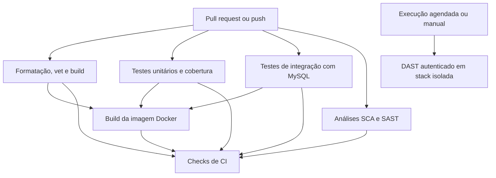

# CI/CD: proposta de pipeline com GitHub Actions

Este documento propõe uma estratégia de integração contínua para o Sistema de Oficina Mecânica. O objetivo é validar alterações automaticamente antes do merge, reutilizando os comandos e ferramentas que já fazem parte do projeto.

O escopo inicial cobre **CI**: compilação, testes, validações estáticas e segurança. A publicação e o deploy da aplicação devem ser adicionados depois, em workflows separados e com ambientes protegidos.

## Objetivos

- Dar feedback rápido em pull requests e branches protegidas.
- Executar as mesmas verificações essenciais usadas no desenvolvimento local.
- Testar migrations e comportamento integrado com MySQL real.
- Aplicar permissões mínimas aos workflows e não expor segredos a código não confiável.
- Manter verificações independentes e resultados fáceis de diagnosticar.

## Visão geral do fluxo



Os jobs de qualidade (formatação, vet e build), testes unitários/cobertura, integração, SCA e SAST são independentes e executam em paralelo. Apenas etapas com dependência de dados ou resultados devem compartilhar job ou declarar `needs`; por exemplo, gerar o profile precede a checagem de cobertura, e gerar o JSON do scanner precede a política correspondente.

Paralelismo reduz o tempo de espera, mas não reduz necessariamente o consumo de minutos: os minutos de todos os jobs continuam sendo somados. Para controlar uso/custo, limite execuções redundantes com `concurrency` (já configurado), mantenha jobs focados e curtos e use filtros de paths para não rodar a suíte quando apenas Markdown mudar. O workflow ignora `**/*.md` em pushes e PRs; qualquer mudança de código, configuração ou workflow continua disparando a CI. `workflow_dispatch` sempre permite executar manualmente, inclusive para validar apenas alterações documentais. Não execute testes simultaneamente duplicados: cobertura já roda os testes unitários e deve ser a mesma execução que alimenta o verificador de cobertura.

## Gatilhos

O workflow principal deve executar em:

- `pull_request` direcionado à `main`;
- `push` em todas as branches, incluindo branches de trabalho e release;
- `workflow_dispatch` para execução manual.

As branches podem ser usadas para trabalho e release, sem convenção obrigatória de nome. Os pushes executam o workflow diretamente na branch, sem exigir merge ou pull request para `main`. Pull requests direcionados à `main` também executam as mesmas verificações.

Use `concurrency` com grupo baseado no workflow e na branch ou número do PR, com cancelamento de execuções anteriores. Isso evita consumir runners em commits superados.

Não use `pull_request_target` para executar código do pull request. Esse evento pode conceder contexto privilegiado; para a CI comum, `pull_request` permite validar contribuições sem disponibilizar segredos do repositório a forks.

## Jobs propostos

O workflow implementado separa as verificações em jobs paralelos: `quality`, `generated`, `unit`, `integration`, `sca` e `sast`. Isso permite que falhas rápidas de formatação/build apareçam sem aguardar os testes mais longos. O job `generated` executa as mesmas gerações de mocks e Swagger do hook local e falha se os arquivos gerados não estiverem commitados. Após qualidade e testes passarem, `image` constrói a imagem Docker sem publicar. O perfil de cobertura e os relatórios de segurança são processados no mesmo job que os gera, evitando upload/download entre jobs.

Cada job possui `timeout-minutes` para limitar consumo em execução travada. Os checkouts usam `actions/checkout@v4` com `persist-credentials: false`, pois nenhum job precisa enviar alterações de volta ao repositório. `setup-go` está fixado por SHA; `upload-artifact` usa a versão `v7.0.2`.

### Validação estática

Executada em runner Linux hospedado pelo GitHub:

1. Checkout do repositório.
2. Instalação da versão de Go indicada pelo `go.mod`, atualmente `1.26.6`.
3. Cache de dependências usando o `go.sum`.
4. Verificação de formatação (`gofmt -l`).
5. `go vet ./...`.
6. Validação de geração de mocks e Swagger em job próprio, com versões controladas dos geradores.

Para geração, gere os arquivos em um checkout limpo e falhe se `git diff --exit-code` encontrar alterações. Dessa forma, o pipeline acusa arquivos derivados desatualizados sem modificar o commit.

### Testes unitários, cobertura e compilação

Execute:

```bash
go test ./... -cover
go build ./...
```

O alvo atual `make test` executa os testes unitários com cobertura. A compilação explícita continua útil porque deixa essa garantia visível como etapa própria.

O gate de cobertura é **mínimo de 80% por pacote elegível** nos pacotes de `internal/application`, `internal/domain` e `internal/infrastructure` que possam ser testados de forma significativa. O workflow usa `go-test-coverage` com configuração versionada em `.testcoverage.yml`. Além de mocks e código gerado, ficam fora do cálculo os executáveis em `cmd`, a documentação Swagger gerada, migrações e helpers de teste, o pacote de composição `wiring`, o pacote raiz de conexão/bootstrap MySQL e os arquivos `routes.go`, que apenas registram rotas e são validados nos testes de integração. Os pacotes de repositório por domínio continuam sujeitos ao limite. Pacotes elegíveis abaixo de 80% fazem o job falhar e devem receber testes até alcançar a meta. Não há baseline temporário nem tolerância de regressão.

Na prática, a verificação gera um profile com `go test -coverprofile` e `go-test-coverage` compara cada pacote elegível contra 80%. O resultado é visível no log e o profile é publicado como artefato.

### Testes de integração

O projeto já possui testes de integração com a build tag `integration`. O `TestMain` inicia um container MySQL 8 com Testcontainers, aplica as migrations reais e monta o router completo.

Comando:

```bash
go test -tags integration ./test/integration/... -v
```

Use um runner hospedado com Docker disponível. Não é necessário iniciar um serviço MySQL adicional no workflow: o próprio Testcontainers gerencia o banco de teste. Não passe `.env` nem credenciais de produção; as configurações usadas no teste são efêmeras.

### Build da imagem Docker

Depois de passarem qualidade, testes unitários/cobertura e integração, o job `image` executa `docker build` usando o Dockerfile do projeto. Essa etapa valida a imagem que futuramente poderá ser publicada; no estado atual, a imagem é construída apenas no runner e não é enviada a um registry.

### SCA: vulnerabilidades em dependências

Execute `govulncheck` em job separado, com uma versão explícita e controlada da ferramenta. O comando local documentado é:

```bash
govulncheck ./...
```

O resultado aparece no log do job e falha para vulnerabilidades **críticas ou altas confirmadas e alcançáveis** no código executado. `.github/scripts/check_security.go` interpreta os eventos JSON, relaciona os call stacks com a severidade OSV e aplica a política. O relatório é publicado como artefato de sete dias. Resultados médios/baixos continuam visíveis, mesmo quando não bloqueiam o merge.

### SAST: análise estática de segurança

Execute `gosec` em job separado, também com versão controlada. O comando local gera um relatório em JSON:

```bash
gosec -fmt=json -out=security/reports/gosec.json ./...
```

O workflow executa o scanner diretamente, sem depender do `make sec-sast` que ainda contém `|| true`. Essa opção mascara o código de saída do scanner no alvo local e deve ser corrigida antes de reutilizá-lo como gate. `.github/scripts/check_security.go` aplica o bloqueio a achados **críticos ou altos com alta confiança**. O relatório é publicado como artefato de sete dias. Falsos positivos devem ser tratados por exclusões justificadas e revisáveis, não ignorando qualquer erro do comando.

### Política de bloqueio e exceções SCA/SAST

Um achado bloqueante impede o merge até que seja corrigido ou aceite formalmente como exceção. A exceção deve:

- identificar a regra/CVE e os arquivos ou dependências afetados;
- explicar por que o achado não é explorável, é falso positivo ou será aceito temporariamente;
- registrar responsável e data de expiração/revisão;
- ser armazenada em configuração versionada, revisada junto com o código;
- ser removida quando a correção ou atualização da dependência for concluída.

Não criar supressões sem prazo ou justificativa. A política inicial bloqueia SCA crítico/alto alcançável e SAST crítico/alto com alta confiança; demais severidades continuam visíveis para priorização. Mudanças na política ou em exclusões devem passar por revisão de código.

### DAST: OWASP ZAP

O DAST não precisa bloquear todo pull request no primeiro estágio. O script `security/zap-scan.sh` sobe uma stack isolada de aplicação e MySQL, semeia usuários e dados e executa scans autenticados por papel.

Política inicial:

- executar semanalmente em agenda e sob demanda (`workflow_dispatch`);
- considerar execução a cada merge na `main` quando o tempo e a estabilidade forem conhecidos;
- publicar relatórios como artefatos com retenção limitada;
- bloquear alertas críticos e altos confirmados;
- documentar falsos positivos com evidência, justificativa e referência no arquivo de regras do ZAP;
- revisar o tratamento atual de falhas antes de torná-lo gate, pois o script continua mesmo quando o comando do ZAP retorna erro (`|| true`).

Alertas médios e baixos devem continuar nos relatórios para triagem, sem bloquear inicialmente. Depois de calibrar o scanner, o time pode reavaliar severidades e se deve rodar também a cada merge na `main`.

Nunca aponte esse scan para produção ou para o banco de desenvolvimento. A stack descartável existente deve continuar isolada.

## Segurança dos workflows

- Defina `permissions` explicitamente no workflow e, se possível, por job. Para CI de leitura, normalmente basta `contents: read`.
- Não exponha secrets nos jobs de `pull_request`, em especial para PRs de forks.
- Não execute código de PR com `pull_request_target` e contexto privilegiado.
- Fixe actions de terceiros por SHA completo revisado, em vez de tags mutáveis. O workflow mantém `actions/checkout@v4` como exceção explícita; para imutabilidade estrita, fixe também essa action por SHA. Registre uma política para atualizar referências regularmente.
- Use versões explícitas de Go e ferramentas; evite instalar ferramentas com `@latest` em cada execução.
- Não faça upload de `.env`, tokens, dumps do banco ou relatórios que contenham dados sensíveis.
- Separe permissões e segredos de deploy da CI. O workflow de deploy deve usar GitHub Environments, aprovação quando apropriado e credenciais de curta duração sempre que possível.

## Artefatos e relatórios

Publique como artefatos apenas saídas úteis para análise, como cobertura e relatórios SCA/SAST/DAST. Defina nomes previsíveis, retenção limitada e verifique que nenhum artefato contém credenciais ou dados pessoais.

Cache é para dependências baixadas e aceleração. Artefatos são para resultados de uma execução. Não use cache como mecanismo de transporte de relatórios entre jobs.

## Integração com comandos existentes

| Verificação | Comando do projeto ou equivalente | Observação |
|---|---|---|
| Testes unitários | `make test` ou `go test ./... -coverprofile=coverage.out -covermode=atomic` | Não exige serviço externo |
| Testes de integração | `make test-integration` | Testcontainers requer Docker |
| Lint estático | `make lint` (`go vet ./...`) | Considere adicionar formatação como check explícito |
| Build | `go build ./...` | Checa todos os pacotes compiláveis |
| Mocks e Swagger | `mockery` + `swag init` | Regenera em checkout limpo e falha se houver diff |
| Imagem Docker | `docker build` | Executado após qualidade e testes; ainda sem push |
| Cobertura | `go test ./... -coverprofile=coverage.out` + `go-test-coverage` | 80% por pacote elegível; falha direta abaixo da meta |
| SCA | `govulncheck -json ./...` + `check_security.go` | Bloqueia alta/crítica alcançável; publica JSON |
| SAST | `gosec -fmt=json ...` + `check_security.go` | Bloqueia alta/crítica com alta confiança; publica JSON |
| DAST | `make sec-dast` | Inicialmente agendado/manual; revisar tolerância a falhas |

O hook local `.dev/hooks/stubs/pre-push.stub` também gera mocks e Swagger. A CI deve complementar a rotina local e ser a fonte confiável dos checks de merge, sem exigir que desenvolvedores configurem hooks para que o repositório esteja protegido.

## Deploy, promoção e rollback

O provedor de hospedagem ainda não está definido. A proposta de entrega permanece independente dele: construir uma imagem Docker uma única vez, identificá-la por commit ou digest imutável e publicar em um registry. Promover a mesma imagem de staging para produção evita que ambientes executem builds diferentes do mesmo commit.

Fluxo sugerido:

```text
CI aprovada na main
        ↓
build e publicação da imagem imutável
        ↓
deploy em staging + health checks
        ↓
aprovação do ambiente de produção
        ↓
deploy em produção da mesma imagem
```

Use GitHub Environments distintos para `staging` e `production`, com secrets e permissões separados. Configure aprovação humana no ambiente de produção e restrinja quais branches podem implantar. O deploy deve ficar em workflow separado da CI de pull requests; jobs de PR não recebem credenciais de publicação ou produção.

Para rollback da aplicação, mantenha disponível a imagem do release anterior e reimplante esse artefato conhecido. Acompanhe o deploy por health checks e logs; se a validação pós-deploy falhar, interrompa a promoção e reimplante a imagem anterior.

Migrations requerem compatibilidade entre versões antiga e nova da aplicação. Prefira o padrão expandir/migrar/contrair: adicionar estruturas compatíveis, migrar dados, publicar o código que as usa e remover estruturas antigas em uma entrega posterior. Não dependa de rollback automático de schema como mecanismo primário de recuperação, pois migrations destrutivas podem perder dados ou impedir a execução da versão anterior.

## Proteção da branch

Depois de estabilizar os jobs, configure a branch `main` para exigir os checks de CI antes do merge. Exija revisão de código conforme o processo do time e bloqueie force push, quando adequado. Marque como obrigatórios os checks determinísticos de formato, build, testes unitários, cobertura mínima, integração, SCA e SAST; o DAST semanal/manual não é gate inicial de PR.

Os nomes dos checks devem ser estáveis, pois a proteção de branch referencia esses nomes.

## Plano de adoção

1. Criar o workflow de CI com formatação, `go vet`, testes unitários e build.
2. Adicionar integração MySQL com Testcontainers e validar estabilidade em PRs reais.
3. Adicionar `govulncheck` e `gosec`; corrigir o tratamento de saída do alvo SAST.
4. Tornar os checks estáveis obrigatórios na branch principal.
5. Adicionar DAST agendado/manual, tratar os códigos de saída e publicar relatórios.
6. Implementar deploy em workflow separado, com ambiente protegido, somente quando o destino e a estratégia de release estiverem definidos.

## Decisões definidas e pendentes

Definido:

- branch principal: `main`; as demais branches podem ser de trabalho ou release, sem padrão obrigatório; CI executa em push em todas as branches e em PR para `main`;
- cobertura: pelo menos 80% por pacote elegível de `application`, `domain` e `infrastructure`, aplicada por `go-test-coverage`, excluindo mocks/código gerado e os pacotes sem lógica testável listados em `.testcoverage.yml`;
- SCA: bloquear achados críticos/altos confirmados e alcançáveis;
- SAST: bloquear achados críticos/altos com alta confiança;
- exceções: justificadas, versionadas, revisadas e com responsável e prazo de revisão;
- DAST: semanal e manual inicialmente, bloqueando alertas críticos/altos confirmados; avaliar execução por merge na `main` após calibrar;
- deploy: imagem imutável, staging e health checks, promoção da mesma imagem e aprovação humana para produção;
- rollback: reimplantar imagem anterior e manter migrations compatíveis pelo padrão expandir/migrar/contrair.

Pendente:

- provedor e destino efetivo de deploy e registry;
- duração/retenção de artefatos e relatórios;
- detalhes operacionais de rollback e observabilidade, que dependem da plataforma escolhida.

As decisões pendentes não impedem a implantação da CI. O workflow deve permanecer uma automação de validação e entrega, sem transferir regras de negócio para o pipeline.
