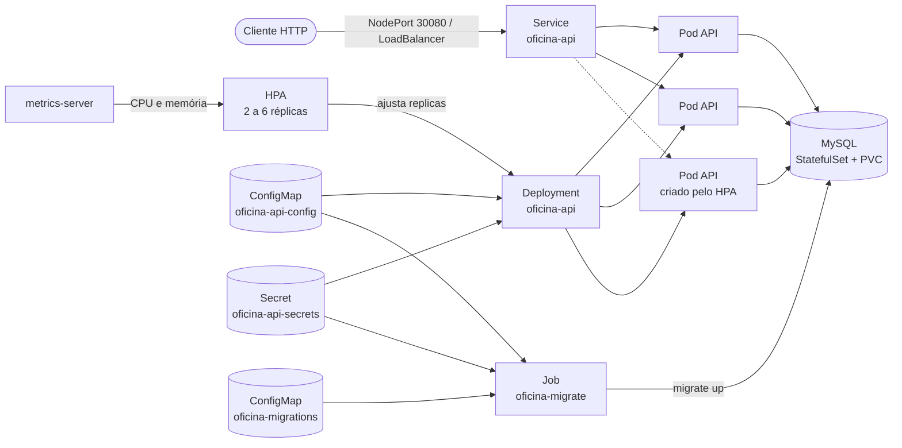

# Kubernetes

Este documento explica como a API roda no Kubernetes: quais recursos existem em [`k8s/`](../k8s/), por que cada um está configurado do jeito que está, como subir tudo no Minikube e quais comandos `kubectl` usar no dia a dia. O deploy em nuvem (EKS + RDS) reaproveita a mesma base e depende do Terraform em `/infra`; a seção [EKS](#eks) descreve o que muda.

## Sumário

- [Visão geral](#visão-geral)
- [Estrutura de `k8s/`](#estrutura-de-k8s)
- [Decisões de configuração](#decisões-de-configuração)
- [Requisitos da máquina](#requisitos-da-máquina)
- [Deploy no Minikube](#deploy-no-minikube)
- [Comandos kubectl do dia a dia](#comandos-kubectl-do-dia-a-dia)
- [Demonstração do autoscaling](#demonstração-do-autoscaling)
- [Problemas comuns](#problemas-comuns)
- [EKS](#eks)

## Visão geral



Todos os recursos ficam no namespace `oficina`.

| Recurso | Nome | Para que serve |
|---|---|---|
| Deployment | `oficina-api` | Pods da API, com probes, limites de recurso e encerramento gracioso |
| Service | `oficina-api` | Endereço estável da API. `NodePort` no Minikube, `LoadBalancer` no EKS |
| HorizontalPodAutoscaler | `oficina-api` | Escala a API de 2 a 6 réplicas por CPU (70%) e memória (80%) |
| ConfigMap | `oficina-api-config` | Variáveis de ambiente não sensíveis (porta, host e nome do banco, pool de conexões, TTL do JWT) |
| Secret | `oficina-api-secrets` | `DB_PASSWORD` e `JWT_SECRET`, gerados a partir de um arquivo local que não vai para o git |
| Job | `oficina-migrate` | Aplica as migrations de `migrations/mysql/` uma vez a cada deploy |
| ConfigMap | `oficina-migrations` | Os arquivos `.sql`, montados no Job. Criado pelo `make k8s-migrate` |
| StatefulSet + Service headless | `oficina-mysql` | MySQL 8 com volume persistente. Só no Minikube |
| Namespace | `oficina` | Isola tudo acima |

## Estrutura de `k8s/`

```
k8s/
├── base/                      # comum a qualquer cluster
│   ├── kustomization.yaml     # ConfigMap da API (configMapGenerator)
│   ├── api-deployment.yaml
│   ├── api-service.yaml       # ClusterIP
│   └── api-hpa.yaml
├── overlays/
│   ├── minikube/              # ambiente local
│   │   ├── kustomization.yaml # namespace, imagem local, DB_HOST, Secret
│   │   ├── namespace.yaml
│   │   ├── mysql-statefulset.yaml
│   │   ├── mysql-service.yaml
│   │   ├── api-service-patch.yaml   # NodePort 30080
│   │   └── secrets.env.example
│   └── eks/                   # AWS, banco no RDS
│       ├── kustomization.yaml
│       ├── namespace.yaml
│       ├── api-service-patch.yaml   # LoadBalancer
│       └── secrets.env.example
└── migrate/                   # Job de migration, aplicado à parte
    ├── kustomization.yaml
    └── job.yaml
```

Os manifestos são organizados com [Kustomize](https://kubectl.docs.kubernetes.io/references/kustomize/), que já vem embutido no `kubectl` (`kubectl apply -k`). A `base` descreve a API sem saber em que cluster vai rodar. Cada overlay acrescenta o que é específico do ambiente: namespace, imagem, onde está o banco, como expor o Service e de onde vêm os segredos. O MySQL só existe no overlay `minikube`, porque em nuvem o banco é um serviço gerenciado.

O Job de migration fica fora dos overlays. O motivo está na [ADR 0006](adr/0006-migrations-em-job-kubernetes.md): o template de um Job não pode ser alterado depois de criado, então ele é apagado e recriado a cada deploy por um alvo próprio do Makefile.

Para ver exatamente o YAML que vai para o cluster, sem aplicar nada:

```bash
kubectl kustomize k8s/overlays/minikube
kubectl kustomize k8s/migrate
```

## Decisões de configuração

| Ponto | Configuração | Motivo |
|---|---|---|
| Requests e limits | API: requests `100m` CPU / `64Mi`, limits `500m` / `256Mi` | O HPA calcula a utilização em relação aos requests. Sem eles as metas ficam `<unknown>` e nada escala. Os limits impedem que um pod sozinho consuma o nó |
| `startupProbe` | `GET /v1/health/live`, a cada 2s, até 15 falhas | Dá até 30s para o processo subir antes das outras probes começarem a contar |
| `livenessProbe` | `GET /v1/health/live`, a cada 10s, 3 falhas | Só confirma que o processo responde. Não consulta o banco: se consultasse, uma queda do MySQL reiniciaria todas as réplicas em loop sem resolver nada |
| `readinessProbe` | `GET /v1/health/ready`, a cada 5s, 2 falhas | Faz ping no MySQL. Se falhar, o pod sai do Service (para de receber requisições) mas não é reiniciado, e volta sozinho quando o banco responder |
| Encerramento | `preStop: sleep 5`, shutdown da API com 15s, `terminationGracePeriodSeconds: 30` | Quando o HPA reduz réplicas ou um rollout troca pods, o Service leva alguns segundos para tirar o pod da lista. O `sleep` cobre esse intervalo; depois a API para de aceitar conexões e termina as requisições em andamento (`cmd/api/serve.go`) |
| Rollout | `maxSurge: 1`, `maxUnavailable: 0` | Um pod novo precisa estar pronto antes de um antigo sair |
| Segurança do container | usuário 1000, sem root, filesystem somente leitura, sem capabilities | A API não escreve em disco; o usuário 1000 é o mesmo criado no `Dockerfile` |
| HPA | `autoscaling/v2`, 2 a 6 réplicas, CPU 70%, memória 80% | O enunciado pede escala por CPU e memória. O mínimo de 2 mantém a API no ar durante rollouts |
| Redução de réplicas | `scaleDown.stabilizationWindowSeconds: 60` | O padrão é 300s. Um minuto evita oscilação e deixa a redução visível na demonstração |
| Sem `replicas` no Deployment | o HPA controla a quantidade | Se o campo estivesse no YAML, cada `kubectl apply` voltaria a contagem ao valor fixo, desfazendo a escala |
| Pool de conexões | `DB_MAX_OPEN_CONNS=10` | 6 réplicas x 10 = 60 conexões, abaixo do `max_connections` padrão do MySQL (151) |
| Segredos | `secretGenerator` lendo `secrets.env` (no `.gitignore`) | Nenhum valor sensível fica escrito nos YAML do repositório. Só o `secrets.env.example`, com placeholders, é versionado |
| Nomes fixos | `generatorOptions.disableNameSuffixHash: true` | O Job de migration referencia o ConfigMap e o Secret pelo nome a partir de outra kustomization. Por isso mudanças de configuração exigem `rollout restart`, que o `make k8s-deploy` já faz |
| Migrations | Job com `migrate/migrate:v4.19.1` | Roda uma vez por deploy, não em cada pod criado pelo HPA, e mantém a imagem da API com um único binário. Detalhes na [ADR 0006](adr/0006-migrations-em-job-kubernetes.md) |
| Senha do MySQL | o root usa a mesma `DB_PASSWORD` do Secret | A API conecta como root no ambiente local, então uma chave só evita que as duas senhas fiquem diferentes |

## Requisitos da máquina

### Ferramentas

| Ferramenta | Versão mínima | Uso | Como verificar |
|---|---|---|---|
| Docker (Desktop ou Engine), rodando | 24 | Driver do Minikube e build da imagem | `docker info` |
| Minikube | 1.32 | Cluster Kubernetes local | `minikube version` |
| kubectl | 1.27 | Aplicar os manifestos. A partir da 1.27 traz o Kustomize v5 embutido | `kubectl version --client` |
| Grafana k6 | 0.50 | Teste de carga para a demonstração do HPA | `k6 version` |
| Go | 1.26 (a do `go.mod`) | Rodar `cmd/seed` e `cmd/create-user` contra o banco do cluster | `go version` |
| GNU Make | 3.81 | Atalhos `make k8s-*` e `make load-test` | `make --version` |

Instalação no macOS com Homebrew:

```bash
brew install minikube kubectl k6
```

No Linux, use os instaladores oficiais: [Minikube](https://minikube.sigs.k8s.io/docs/start/), [kubectl](https://kubernetes.io/docs/tasks/tools/), [k6](https://grafana.com/docs/k6/latest/set-up/install-k6/).

Versões com que este guia foi testado: Minikube 1.39.0 (Kubernetes 1.37.0), kubectl 1.37.1, k6 1.4.2, Docker 29.8.2, Go 1.26.6, GNU Make 3.81.

No macOS o `brew install minikube` instala ou atualiza o `kubectl` junto (o pacote `kubernetes-cli` é dependência). O Kubernetes suporta diferença de no máximo uma versão menor entre `kubectl` e cluster, então se o seu `kubectl` for bem mais antigo que o Kubernetes do Minikube, atualize-o.

### Recursos de hardware

Reserve para o Minikube pelo menos 4 vCPUs, 6 GB de RAM e 20 GB de disco livre. Para agendar os pods, o Kubernetes olha só os requests (6 réplicas x 100m mais 250m do MySQL cabem em 2 CPUs), mas durante o teste de carga cada réplica pode usar até o limite de 500m. Com 4 vCPUs sobra espaço para esses picos; com menos, os pods disputam CPU, a latência sobe e a demonstração do HPA fica difícil de ler.

No Docker Desktop, confira em *Settings > Resources* se a VM tem pelo menos esses valores disponíveis, senão o `minikube start` falha.

### Addon obrigatório

O HPA lê CPU e memória do `metrics-server`, que no Minikube vem desligado:

```bash
minikube addons enable metrics-server
```

Leva cerca de um minuto para começar a coletar. Quando `kubectl top nodes` devolver números, está funcionando.

### Arquivo local de segredos

```bash
cp k8s/overlays/minikube/secrets.env.example k8s/overlays/minikube/secrets.env
```

Edite o `secrets.env` e troque os dois `changeme`. A `DB_PASSWORD` deve ter apenas letras e números, porque entra na URL de conexão do Job de migration. Para o `JWT_SECRET`, `openssl rand -hex 32` gera um valor adequado.

### Checklist

Rode o bloco abaixo; cada linha deve imprimir uma versão ou uma confirmação, sem erro:

```bash
docker info --format 'docker {{.ServerVersion}}: {{.NCPU}} CPUs, {{.MemTotal}} bytes'
minikube version --short
kubectl version --client
k6 version
go version
make --version | head -1
minikube status
minikube addons list | grep metrics-server
kubectl --context minikube top nodes
test -f k8s/overlays/minikube/secrets.env && echo "secrets.env ok"
```

## Deploy no Minikube

Os alvos `make k8s-*` passam `--context minikube` para o `kubectl` em todo comando, então um contexto de outro cluster ativo no seu kubeconfig nunca é usado sem você pedir. O overlay e o contexto andam juntos: `K8S_OVERLAY=minikube` só é aceito com `KUBE_CONTEXT=minikube`, e qualquer outro overlay exige um `KUBE_CONTEXT` diferente de `minikube`. Fora do Minikube, o `make k8s-delete` também pede `CONFIRM=yes`.

### 1. Subir o cluster

```bash
minikube start --cpus=4 --memory=6g --disk-size=20g
minikube addons enable metrics-server
```

O `minikube start` troca o contexto atual do `kubectl` para `minikube`. Se você usa outros clusters, lembre de voltar depois com `kubectl config use-context <outro>`.

O primeiro deploy completo, do `make k8s-deploy` até a API pronta, leva por volta de um minuto, a maior parte esperando o MySQL inicializar.

### 2. Construir a imagem dentro do Minikube

```bash
make k8s-build
```

Equivale a `minikube image build -t oficina-api:local .`. A imagem é construída direto no runtime do Minikube, então não precisa de registry. O Deployment usa `imagePullPolicy: IfNotPresent` justamente para não tentar baixar `oficina-api:local` de fora.

Repita este passo sempre que mudar o código Go.

### 3. Aplicar os manifestos, migrar e subir a API

```bash
make k8s-deploy
```

O alvo executa, em ordem:

```bash
# 1. aplica namespace, ConfigMap, Secret, MySQL, Deployment, Service e HPA
kubectl --context minikube apply -k k8s/overlays/minikube

# 2. espera o MySQL ficar pronto
kubectl --context minikube -n oficina rollout status statefulset/oficina-mysql --timeout=180s

# 3. gera o ConfigMap com os .sql a partir de migrations/mysql
kubectl --context minikube -n oficina create configmap oficina-migrations \
  --from-file=migrations/mysql --dry-run=client -o yaml \
  | kubectl --context minikube apply -f -

# 4. recria o Job de migration e espera terminar
kubectl --context minikube -n oficina delete job oficina-migrate --ignore-not-found
kubectl --context minikube apply -k k8s/migrate
kubectl --context minikube -n oficina get job oficina-migrate -w   # até COMPLETIONS 1/1 (ou falha)
kubectl --context minikube -n oficina logs job/oficina-migrate

# 5. reinicia a API para pegar configuração nova e espera o rollout
kubectl --context minikube -n oficina rollout restart deployment/oficina-api
kubectl --context minikube -n oficina rollout status deployment/oficina-api --timeout=180s
```

No passo 4 o alvo do Makefile consulta o estado do Job a cada 2 segundos e para assim que ele termina, com sucesso (`Complete`) ou depois de esgotar as tentativas (`Failed`). Uma migration com erro faz o alvo imprimir o log do Job e sair com erro em cerca de 30 segundos, sem reiniciar a API. O `kubectl wait` não serve aqui porque só espera uma condição: esperando apenas `Complete`, uma falha seguraria o deploy até o timeout.

O `make k8s-deploy` pode ser repetido quantas vezes for preciso. Na segunda execução o `apply` reporta `unchanged` para quase tudo e o migrate responde `no change`.

O `statefulset.apps/oficina-mysql configured` aparece em todo `apply`, mesmo sem nada ter mudado. É uma limitação do `kubectl apply` com `volumeClaimTemplates`: o servidor completa o template com campos padrão (`volumeMode`, `status`) e, como essa lista não tem chave de merge, o kubectl sempre reenvia a lista inteira. Nada é alterado no cluster; `kubectl diff -k k8s/overlays/minikube` sai vazio.

Sobre a ordem: no primeiro deploy a API sobe junto com o MySQL, alguns segundos antes das tabelas existirem, e o restart do passo 5 resolve isso. Nos deploys seguintes a API antiga continua atendendo enquanto o Job roda, então toda migration precisa funcionar com a versão anterior da API. Uma coluna ou tabela nova entra num deploy, e a antiga só é removida num deploy seguinte.

### 4. Acessar a API

```bash
make k8s-url
```

Equivale a `minikube service oficina-api -n oficina --url`. O comportamento depende do sistema:

- **Linux**: imprime algo como `http://192.168.49.2:30080` e termina. O IP do Minikube é acessível direto do host.
- **macOS e Windows com o driver Docker**: o IP do Minikube não é acessível do host, então o comando abre um túnel, imprime uma URL do tipo `http://127.0.0.1:54321` e fica rodando. Deixe esse terminal aberto enquanto usar a API; fechar o terminal fecha o túnel.

Guarde a URL numa variável para os próximos comandos:

```bash
export BASE_URL=http://127.0.0.1:54321   # use a URL que o comando imprimiu

curl "$BASE_URL/v1/health/ready"
# {"status":"ok"}
```

O Swagger fica em `$BASE_URL/swagger/index.html`.

Para acessos rápidos também funciona `kubectl port-forward service/oficina-api 8080:80`. Ele não serve para o teste de carga, porque o port-forward escolhe um único pod e manda todo o tráfego para ele, sem passar pelo balanceamento do Service.

### 5. Popular o banco

O banco começa vazio. Para criar usuários e dados de exemplo, abra um túnel até o MySQL e rode o seed localmente apontando para ele:

```bash
# terminal 1: deixe rodando
kubectl --context minikube -n oficina port-forward pod/oficina-mysql-0 3307:3306

# terminal 2
DB_HOST=127.0.0.1 DB_PORT=3307 DB_USER=root DB_NAME=mecanica \
DB_PASSWORD=<valor do secrets.env> JWT_SECRET=<valor do secrets.env> \
go run ./cmd/seed
```

A porta local 3307 evita conflito com um MySQL do `docker compose` que esteja na 3306. O seed imprime as credenciais criadas (admin, atendente, mecânico e cliente). Para criar só um usuário interno, use `go run ./cmd/create-user` com as mesmas variáveis.

### 6. Remover tudo

```bash
make k8s-delete
```

Apaga o Job, o ConfigMap das migrations e todo o overlay, inclusive o namespace e o volume do MySQL. Os dados do banco não voltam. Para desligar o cluster sem apagar nada, use `minikube stop`.

## Comandos kubectl do dia a dia

Os exemplos abaixo assumem o contexto e o namespace certos. Para não repetir `--context minikube -n oficina` em todo comando:

```bash
kubectl config use-context minikube
kubectl config set-context --current --namespace=oficina
```

### Ver o estado

```bash
kubectl get pods,svc,hpa,jobs          # visão geral (o mesmo que make k8s-status)
kubectl get pods -o wide               # em qual nó e com qual IP cada pod está
kubectl get pods -w                    # acompanha mudanças em tempo real
kubectl describe deployment oficina-api
kubectl describe pod <nome-do-pod>     # eventos, probes falhando, motivo de restart
kubectl get events --sort-by=.lastTimestamp
```

### Logs

```bash
kubectl logs deployment/oficina-api            # um dos pods da API
kubectl logs -l app.kubernetes.io/name=oficina-api --prefix -f   # todos os pods, seguindo
kubectl logs pod/<nome-do-pod> --previous      # log do container antes do último restart
kubectl logs job/oficina-migrate               # saída da migration
kubectl logs statefulset/oficina-mysql
```

### Consumo de recursos

Precisam do `metrics-server`:

```bash
kubectl top nodes
kubectl top pods
kubectl get hpa oficina-api -w
kubectl describe hpa oficina-api      # metas, valores atuais e histórico de decisões
```

### Acesso direto

```bash
kubectl port-forward service/oficina-api 8080:80       # API em localhost:8080
kubectl port-forward pod/oficina-mysql-0 3307:3306     # MySQL em localhost:3307
kubectl exec -it pod/oficina-mysql-0 -- sh -c 'mysql -uroot -p"$MYSQL_ROOT_PASSWORD" mecanica'
```

A imagem da API é um Alpine mínimo: tem `sh` (`kubectl exec -it deployment/oficina-api -- sh`), mas nenhuma ferramenta de rede ou depuração. Na maioria dos casos logs e `describe` resolvem.

### Rollout

```bash
kubectl rollout status deployment/oficina-api
kubectl rollout history deployment/oficina-api
kubectl rollout restart deployment/oficina-api   # recria os pods, por exemplo depois de mudar o secrets.env
kubectl rollout undo deployment/oficina-api      # volta para a revisão anterior
```

### Configuração e segredos

```bash
kubectl get configmap oficina-api-config -o yaml
kubectl get secret oficina-api-secrets -o jsonpath='{.data.JWT_SECRET}' | base64 -d
```

Para mudar um valor, edite o arquivo de origem (o `kustomization.yaml` do overlay ou o `secrets.env`) e rode `make k8s-deploy`. Editar direto no cluster com `kubectl edit` funciona, mas é desfeito no próximo deploy.

### Escala manual

```bash
kubectl scale deployment/oficina-api --replicas=4
```

Com o HPA ativo, ele volta a ajustar a quantidade em poucos segundos. Para testar sem o HPA interferir, apague-o antes (`kubectl delete hpa oficina-api`) e reaplique depois com `make k8s-apply`.

## Demonstração do autoscaling

O script [`test/load/ordens-servico.js`](../test/load/ordens-servico.js) faz login uma vez, pega o primeiro cliente e o primeiro veículo cadastrados e então abre Ordens de Serviço (70% das iterações) e lista Ordens de Serviço (30%) em rampa:

| Fase | Duração | Usuários virtuais |
|---|---|---|
| Aquecimento | 30s | 0 a 20 |
| Rampa | 2min | 20 a 100 |
| Platô | 1min | 100 |
| Descida | 30s | 100 a 0 |

O teste falha se mais de 5% das requisições derem erro ou se o p95 da latência passar de 1,5s.

Pré-requisitos: banco populado (passo 5 do deploy) e a URL da API em `BASE_URL` (passo 4). Use três terminais, além do túnel se estiver no macOS:

```bash
# terminal 1: HPA em tempo real
kubectl --context minikube -n oficina get hpa oficina-api -w

# terminal 2: pods sendo criados e removidos
kubectl --context minikube -n oficina get pods -l app.kubernetes.io/name=oficina-api -w

# terminal 3: carga
# BASE_URL é a URL do passo 4 do deploy (com o túnel aberto, no macOS)
make load-test BASE_URL="$BASE_URL" K6_EMAIL=admin@oficina.com K6_SENHA=Senha@123
```

O que esperar (valores de uma execução real num Minikube com 4 vCPUs):

1. Antes da carga o HPA mostra `cpu: 2%/70%, memory: 25%/80%` e 2 réplicas.
2. Cerca de um minuto depois do início a CPU passa da meta (chegou a 125% e 147% nessa execução) e o HPA sobe para 4 ou 5 réplicas. Cada pod novo aparece como `0/1` até a readiness passar, o que leva poucos segundos.
3. Depois que o k6 termina, a CPU cai. Passada a janela de estabilização de 60s, o HPA remove réplicas aos poucos até voltar a 2.

As métricas do `metrics-server` no Minikube são atualizadas a cada 60 segundos, então a coluna `TARGETS` muda em saltos e o HPA reage com até um minuto de atraso.

Resultado do k6 nessa mesma execução: cerca de 26 mil requisições em 4 minutos (108 por segundo no pico), nenhuma falha, latência mediana de 30 ms e p95 de 313 ms.

O ciclo completo, da subida até a volta para 2 réplicas, leva uns 7 minutos. `kubectl describe hpa oficina-api` mostra, na seção *Events*, cada decisão de escala com o motivo:

```
Normal  SuccessfulRescale  horizontal-pod-autoscaler  New size: 4; reason: cpu resource utilization (percentage of request) above target
Normal  SuccessfulRescale  horizontal-pod-autoscaler  New size: 3; reason: All metrics below target
```

## Problemas comuns

### HPA com `<unknown>` nas metas

```
NAME          REFERENCE                TARGETS                        MINPODS   MAXPODS   REPLICAS
oficina-api   Deployment/oficina-api   cpu: <unknown>/70%, ...        2         6         2
```

Causas, da mais provável para a menos:

1. `metrics-server` desligado ou ainda iniciando. Rode `minikube addons enable metrics-server`, espere um minuto e confira com `kubectl top pods`.
2. Pods recém-criados. As primeiras métricas levam de 30 a 60 segundos.
3. Container sem `resources.requests`. Confira com `kubectl get deployment oficina-api -o jsonpath='{.spec.template.spec.containers[0].resources}'`.

### `ErrImagePull` ou `ImagePullBackOff` na API

A imagem `oficina-api:local` não existe dentro do Minikube. Rode `make k8s-build` e depois `kubectl rollout restart deployment/oficina-api`. Lembre que `minikube delete` apaga as imagens construídas.

### API em `CrashLoopBackOff`

Veja o motivo com `kubectl logs pod/<nome> --previous`. Os casos mais comuns:

- `error loading config: ... required environment variable "..." is not set`: falta chave no `secrets.env` ou no ConfigMap.
- `error connecting to MySQL`: o MySQL ainda não subiu ou a senha do `secrets.env` mudou depois que o volume foi criado. O MySQL só lê `MYSQL_ROOT_PASSWORD` na primeira inicialização; trocar a senha depois exige apagar o volume (`make k8s-delete`) ou alterar a senha dentro do banco.

### Pods da API em `0/1 Running`

A readiness está falhando, quase sempre porque a API não consegue falar com o MySQL. `kubectl describe pod <nome>` mostra `Readiness probe failed: HTTP probe failed with statuscode: 503`. Confira se o pod `oficina-mysql-0` está `1/1`. Repare que os pods da API **não** reiniciam nesse caso; voltam para `1/1` sozinhos quando o banco responde.

### Job de migration falhou

```bash
kubectl logs job/oficina-migrate
```

Se o erro for de conexão (`connection refused`, `i/o timeout`), o MySQL ainda não estava pronto; rode `make k8s-migrate` de novo.

Se o erro for no SQL, o golang-migrate marca a versão como suja e qualquer execução seguinte falha com `Dirty database version N. Fix and force version.`. Para recuperar:

1. Corrija o arquivo `.sql` com problema.
2. Desfaça manualmente no banco o que a migration chegou a aplicar, se aplicou algo.
3. Marque a última versão boa (N - 1) como atual:

   ```bash
   # terminal 1
   kubectl --context minikube -n oficina port-forward pod/oficina-mysql-0 3307:3306

   # terminal 2
   DB_HOST=127.0.0.1 DB_PORT=3307 DB_USER=root DB_NAME=mecanica \
   DB_PASSWORD=<valor do secrets.env> JWT_SECRET=<valor do secrets.env> \
   go run ./migrations force <N-1>
   ```

4. Rode `make k8s-migrate` de novo.

### `secrets.env: no such file or directory`

O overlay lê os segredos de `k8s/overlays/<overlay>/secrets.env`, que não é versionado. Copie do `secrets.env.example` ao lado e preencha.

### Erro de parse na URL do banco no Job

Mensagens como `invalid port` ou `parse "mysql://..."` indicam caractere especial na `DB_PASSWORD`. Use uma senha só com letras e números.

## EKS

O overlay [`k8s/overlays/eks`](../k8s/overlays/eks/) reaproveita a base inteira e muda só o que é da AWS:

- não cria MySQL: `DB_HOST` e `DB_USER` apontam para o RDS;
- a imagem vem do ECR em vez de `oficina-api:local`;
- o Service vira `LoadBalancer`, e a AWS cria um Load Balancer público para ele.
- o Deployment usa `imagePullPolicy: Always`, porque a tag `latest` é reaproveitada a cada build e, com `IfNotPresent`, um nó que já tivesse a imagem em cache continuaria rodando a versão antiga. Quando o pipeline publicar uma tag por commit, essa troca deixa de ser necessária.

Os valores marcados com `REPLACE_WITH_...` no `kustomization.yaml` vêm das saídas do Terraform (endpoint do RDS, usuário e URL do repositório ECR), que será escrito em `/infra`. Enquanto isso, o overlay serve para validar que a base funciona sem o MySQL local:

```bash
cp k8s/overlays/eks/secrets.env.example k8s/overlays/eks/secrets.env
kubectl kustomize k8s/overlays/eks
```

Quando o cluster existir, o fluxo é o mesmo do Minikube, trocando o overlay e o contexto:

```bash
make k8s-deploy K8S_OVERLAY=eks KUBE_CONTEXT=<contexto do EKS>
```

No EKS o `metrics-server` não vem instalado por padrão. Ele precisa ser incluído no Terraform do cluster (ou instalado como addon do EKS), senão o HPA fica em `<unknown>` como descrito acima.
