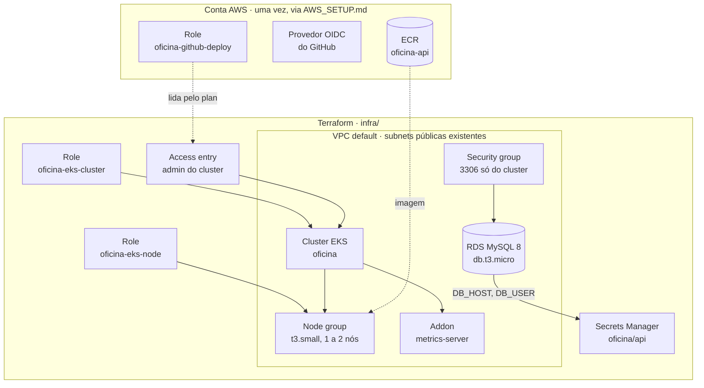

# Terraform

Este documento explica a infraestrutura AWS que o Terraform de [`infra/`](../infra/) cria: quais recursos existem, por que cada um está configurado do jeito que está, o que precisa estar pronto antes, como subir e derrubar o ambiente e como resolver os problemas mais comuns. Os manifestos que rodam dentro do cluster estão em [KUBERNETES.md](KUBERNETES.md), e o pipeline que publica a imagem e faz o deploy está em [CI_CD.md](CI_CD.md).

O Terraform roda fora do pipeline. O job `infra` do [`cd.yml`](../.github/workflows/cd.yml) existe, mas fica desligado até haver um backend remoto para o state (ver [Limitações](#limitações)). O fluxo é: sobe o ambiente com `make tf-apply`, envia a tag de versão para o CD fazer o deploy e derruba tudo com `make tf-destroy` ao terminar.

## Sumário

- [Visão geral](#visão-geral)
- [Estrutura de `infra/`](#estrutura-de-infra)
- [Decisões de configuração](#decisões-de-configuração)
- [Variáveis e saídas](#variáveis-e-saídas)
- [Requisitos](#requisitos)
- [Provisionar o ambiente](#provisionar-o-ambiente)
- [Derrubar o ambiente](#derrubar-o-ambiente)
- [Custos](#custos)
- [Comandos do dia a dia](#comandos-do-dia-a-dia)
- [Problemas comuns](#problemas-comuns)
- [Limitações](#limitações)

## Visão geral



Recursos criados, todos com a tag `Project = soat-oficina`:

| Recurso | Nome | Para que serve |
|---|---|---|
| IAM role | `oficina-eks-cluster` | Assumida pelo EKS para gerenciar o control plane (`AmazonEKSClusterPolicy`) |
| IAM role | `oficina-eks-node` | Assumida pelos nós: `AmazonEKSWorkerNodePolicy`, `AmazonEKS_CNI_Policy`, `AmazonEC2ContainerRegistryReadOnly` e `ses:SendEmail`/`ses:SendRawEmail` |
| Cluster EKS | `oficina` | Kubernetes 1.34, endpoint público, autenticação `API_AND_CONFIG_MAP` |
| Access entry | role `oficina-github-deploy` | Dá ao GitHub Actions a policy `AmazonEKSClusterAdminPolicy` para aplicar os manifestos |
| Launch template | `oficina-node-*` | IMDSv2 obrigatório, com hop limit 2 |
| Node group | `oficina-nodes` | `t3.small`, AMI `AL2023_x86_64_STANDARD`, on-demand, 1 a 2 nós |
| Addon EKS | `metrics-server` | Métricas de CPU e memória para o HPA |
| DB subnet group | `oficina-db` | Subnets onde o RDS pode ficar |
| Security group | `oficina-rds` | Libera a porta 3306 só a partir do security group do cluster |
| RDS | `oficina-mysql` | MySQL 8 (última 8.0), 20 GiB gp3 criptografado, uma zona, database `mecanica` |
| Secrets Manager | `oficina/api` | `DB_HOST`, `DB_USER`, `DB_PASSWORD`, `JWT_SECRET` e `APPROVAL_TOKEN_SECRET`, lidos pelo CD |
| Secrets Manager | `oficina/smtp` | `SMTP_HOST`, `SMTP_PORT`, `SMTP_USERNAME`, `SMTP_PASSWORD` e `SMTP_FROM_ADDRESS`. Envio de e-mail no AWS Academy, no lugar do SES |

Fica de fora, de propósito:

| Recurso | Por quê |
|---|---|
| VPC, subnets e NAT Gateway | O ambiente usa a VPC default e as subnets públicas que já existem. Sem NAT não há custo fixo de rede |
| Repositório ECR `oficina-api` | Guarda as imagens publicadas. Precisa sobreviver ao `destroy` |
| Provedor OIDC e role `oficina-github-deploy` | São o acesso do GitHub Actions à conta. Precisam sobreviver ao `destroy` |
| Load Balancer | Criado pela AWS a partir do Service `LoadBalancer` do overlay EKS, não pelo Terraform |

## Estrutura de `infra/`

```
infra/
├── versions.tf          # versão do Terraform e dos providers aws e random
├── variables.tf         # todas as variáveis, todas com valor padrão
├── main.tf              # VPC e subnets existentes, role de deploy, versão do MySQL
├── iam.tf               # roles do cluster e dos nós
├── eks.tf               # cluster, access entry, launch template, node group e metrics-server
├── rds.tf               # subnet group, security group e instância MySQL
├── secrets.tf           # senhas aleatórias e o secret oficina/api
├── outputs.tf           # nomes, endpoints e o comando do kubeconfig
└── .terraform.lock.hcl  # versões travadas dos providers (versionado)
```

O Terraform de [`infra/`](../infra/) sobe tudo o que o deploy precisa numa conta do **AWS Academy Learner Lab**, região `us-east-1`. Quem roda o `apply` é o próprio CD: cada tag `MAJOR.MINOR.PATCH` na `main` executa o job `infra` ([`.github/workflows/cd.yml`](../.github/workflows/cd.yml)) antes de publicar a imagem e fazer o rollout. Não é preciso rodar `apply` à mão antes de criar a tag.

Ou rode o Terraform direto: `terraform -chdir=infra apply -var ses_from_address=oficina@exemplo.com`.

Saídas, mostradas no fim do `apply` e com `terraform -chdir=infra output`:

| Saída | Conteúdo |
|---|---|
| `cluster_name` | Nome do cluster |
| `cluster_endpoint` | Endpoint da API do Kubernetes |
| `update_kubeconfig` | Comando pronto para apontar o `kubectl` para o cluster |
| `rds_address` | Hostname do RDS, sem porta (o `DB_HOST` do secret) |
| `rds_username` | Usuário master do RDS |
| `app_secret_name` | Nome do secret lido pelo CD |
| `vpc_id` / `subnet_ids` | Rede usada pelo cluster e pelo RDS |

## Requisitos

### Ferramentas

| Ferramenta | Versão mínima | Uso | Como verificar |
|---|---|---|---|
| Terraform | 1.5 | Criar e destruir a infraestrutura | `terraform version` |
| AWS CLI | 2 | Credenciais, `update-kubeconfig` e conferências | `aws --version` |
| kubectl | 1 versão menor de diferença do cluster (1.33 a 1.35 para o padrão 1.34) | Acessar o cluster depois do `apply` | `kubectl version --client` |
| GNU Make | 3.81 | Atalhos `make tf-*` | `make --version` |
| jq (opcional) | 1.6 | Conferir as chaves do secret sem imprimir os valores | `jq --version` |

Instalação no macOS com Homebrew:

```bash
brew install hashicorp/tap/terraform awscli kubectl jq
```

No Linux, use os instaladores oficiais: [Terraform](https://developer.hashicorp.com/terraform/install), [AWS CLI](https://docs.aws.amazon.com/cli/latest/userguide/getting-started-install.html), [kubectl](https://kubernetes.io/docs/tasks/tools/).

Versões com que este guia foi testado: Terraform 1.17.1, provider `hashicorp/aws` 5.100.0, provider `hashicorp/random` 3.9.1, AWS CLI 2.39.3, kubectl 1.37.1.

### Conta AWS

- Uma conta AWS com a região `us-east-1` habilitada. Pode ser outra região, desde que `aws_region`, `eks_availability_zones` e a variable `AWS_REGION` do repositório acompanhem.
- VPC default com subnets públicas em pelo menos duas zonas. Contas novas já vêm assim. Se a VPC default foi apagada, recrie com `aws ec2 create-default-vpc` ou passe `vpc_id` e `subnet_ids`.
- Os passos 1 a 3 do [AWS_SETUP.md](AWS_SETUP.md) feitos: provedor OIDC, role `oficina-github-deploy` e repositório ECR. Os passos 4 (secret) e 5 (access entry) **não** devem ser feitos à mão, o Terraform cria os dois.
- Para enviar e-mail de verdade: o provedor-alvo é o Amazon SES, que exige remetente verificado (e, no sandbox, destinatário verificado). O AWS Academy Learner Lab nega essa verificação, então lá o envio é por SMTP: o secret `SMTP_PASSWORD` no environment `aws-deploy` ([AWS_SETUP.md](AWS_SETUP.md)). Sem esse secret, o CD falha antes do `apply`.

### Credenciais

O Terraform usa a credencial do profile da AWS CLI. O `Makefile` assume o profile `oficina-temp` e a região `us-east-1`, e os dois podem ser trocados na linha de comando (`make tf-plan AWS_PROFILE=meu-profile`).

```bash
aws configure --profile oficina-temp
```

A credencial precisa poder criar e apagar roles e policies do IAM, cluster e node group do EKS, launch templates e security groups do EC2, instâncias RDS e secrets do Secrets Manager. Na prática, um usuário ou role com `AdministratorAccess`. Não grave a access key em nenhum arquivo do repositório.

### Checklist

Rode o bloco abaixo; cada linha deve imprimir uma versão ou um recurso, sem erro:

```bash
export AWS_PROFILE=oficina-temp AWS_REGION=us-east-1
terraform version | head -1
aws --version
kubectl version --client
make --version | head -1
aws sts get-caller-identity --query Account --output text
aws iam get-role --role-name oficina-github-deploy --query Role.Arn --output text
aws ecr describe-repositories --repository-names oficina-api --query 'repositories[0].repositoryUri' --output text
aws ec2 describe-vpcs --filters Name=is-default,Values=true --query 'Vpcs[0].VpcId' --output text
aws secretsmanager describe-secret --secret-id oficina/api 2>/dev/null && echo "ATENÇÃO: secret já existe, importe antes do apply" || echo "secret livre"
```

A conta impressa por `get-caller-identity` deve ser a do projeto. Se o secret `oficina/api` já existir, veja [Secret já existe](#secret-já-existe).

## Provisionar o ambiente

Todos os comandos rodam na raiz do repositório.

### 1. Planejar

```bash
make tf-plan
```

O `tf-plan` roda `terraform init` e `terraform plan`. Na primeira vez o `init` baixa os providers nas versões do `.terraform.lock.hcl`. O plano deve terminar com algo como `Plan: 21 to add, 0 to change, 0 to destroy`.

### 2. Aplicar

```bash
make tf-apply
```

O Terraform mostra o plano de novo e pede `yes`. Leva cerca de 15 a 20 minutos: o cluster EKS sozinho demora de 8 a 12, e o node group e o RDS mais alguns. **A partir daqui o control plane cobra por hora.**

### 3. Apontar o kubectl para o cluster

```bash
aws eks update-kubeconfig --region us-east-1 --name oficina --profile oficina-lab
kubectl get nodes
aws secretsmanager get-secret-value --secret-id oficina/api --query SecretString --output text --profile oficina-lab
aws sesv2 get-email-identity --email-identity soatoficinapos@gmail.com --query VerifiedForSendingStatus --profile oficina-lab
```

Os nós devem aparecer como `Ready`. Se ainda estiverem `NotReady`, espere um ou dois minutos.

### 4. Conferir

```bash
kubectl top nodes                                                     # metrics-server respondendo
aws eks list-access-entries --cluster-name oficina                    # inclui oficina-github-deploy
aws secretsmanager get-secret-value --secret-id oficina/api \
  --query SecretString --output text | jq -r 'keys[]'                 # só as chaves, sem os valores
aws rds describe-db-instances --db-instance-identifier oficina-mysql \
  --query 'DBInstances[0].DBInstanceStatus' --output text             # available
```

### 5. Fazer o deploy

Com os nós `Ready` e o RDS `available`, crie uma tag de versão num commit da `main` que passou na CI:

```bash
git switch main && git pull
git tag 1.0.0
git push origin 1.0.0
```

O CD lê o secret, roda as migrations no RDS e sobe a API. Acompanhe em **Actions → CD**. O passo a passo e o rollback estão em [CI_CD.md](CI_CD.md#parte-2-deploy). A URL da API sai no resumo do run ou com:

```bash
kubectl -n oficina get svc oficina-api -o jsonpath='{.status.loadBalancer.ingress[0].hostname}'
```

## Derrubar o ambiente

A ordem importa. O Service `LoadBalancer` cria um Load Balancer e security groups que o Terraform não conhece. Se eles ainda existirem, o `destroy` trava tentando remover a rede do cluster e o Load Balancer continua cobrando.

**1. Apague o namespace da aplicação**, com o `kubectl` ainda apontando para o cluster:

```bash
kubectl delete namespace oficina
```

**2. Espere o Load Balancer sumir:**

```bash
aws elb describe-load-balancers --query 'LoadBalancerDescriptions[].LoadBalancerName' --output text
```

Quando a saída não mostrar mais o balanceador do cluster, siga.

**3. Destrua a infraestrutura:**

```bash
make tf-destroy CONFIRM=yes
```

O Terraform pede `yes` mais uma vez. ECR, provedor OIDC e role `oficina-github-deploy` continuam na conta, prontos para o próximo `apply`. O RDS é apagado sem snapshot: os dados do banco se perdem.

## Custos

Valores aproximados em `us-east-1` (confira a [página de preços](https://aws.amazon.com/pricing/)):

| Recurso | Custo aproximado |
|---|---|
| Control plane do EKS | US$ 0,10/h, cerca de US$ 73/mês, mesmo sem tráfego |
| Nó `t3.small` on-demand | cerca de US$ 15/mês por nó |
| RDS `db.t3.micro` | cerca de US$ 13 a 15/mês, se não entrar no free tier |
| Load Balancer do Service | cerca de US$ 16 a 18/mês, mais tráfego |
| IPv4 público dos nós | US$ 0,005/h por IP |
| Secrets Manager | US$ 0,40/mês por secret |

Tudo ligado o mês inteiro passa de US$ 110. Suba o ambiente perto da demonstração e derrube depois. Um alerta em **Billing → Budgets** evita surpresa.

## Comandos do dia a dia

Os atalhos do `Makefile` aceitam `AWS_PROFILE` e `AWS_REGION`:

| Comando | O que faz |
|---|---|
| `make tf-init` | `terraform init` em `infra/` |
| `make tf-plan` | `init` + `plan` |
| `make tf-apply` | `init` + `apply`, pedindo confirmação |
| `make tf-destroy CONFIRM=yes` | `destroy`, pedindo confirmação |

Para o resto, chame o Terraform direto, com o profile no ambiente:

```bash
export AWS_PROFILE=oficina-temp AWS_REGION=us-east-1

terraform -chdir=infra output                          # saídas do último apply
terraform -chdir=infra output -raw update_kubeconfig   # comando do kubeconfig
terraform -chdir=infra state list                      # recursos no state
terraform -chdir=infra fmt -check                      # formatação
terraform -chdir=infra validate                        # sintaxe e referências
terraform -chdir=infra apply -var node_desired_size=2  # mudar um valor sem editar arquivo
```

## Problemas comuns

### `plan` falha lendo `oficina-github-deploy`

```
Error: reading IAM Role (oficina-github-deploy): couldn't find resource
```

A role de deploy não existe na conta. Crie seguindo os passos 1 e 2 do [AWS_SETUP.md](AWS_SETUP.md), ou passe o nome de outra role com `-var github_deploy_role_name=...`.

### Control plane recusado numa zona

```
UnsupportedAvailabilityZoneException: Cannot create cluster 'oficina' because us-east-1e ...
```

A lista `eks_availability_zones` inclui uma zona que o EKS não aceita. Em `us-east-1`, a padrão já exclui `us-east-1e`. Em outra região, ajuste a lista com as zonas que a mensagem de erro sugere.

### Versão do Kubernetes recusada

```
InvalidParameterException: unsupported Kubernetes version 1.34
```

A versão saiu do suporte. Veja as aceitas com `aws eks describe-cluster-versions --query 'clusterVersions[].clusterVersion'` e passe a nova em `kubernetes_version`.

### Secret já existe

```
ResourceExistsException: The operation failed because the secret oficina/api already exists.
```

O secret foi criado à mão pelo passo 4 do AWS_SETUP.md ou sobrou de outro state. Importe para o state antes do `apply`:

```bash
AWS_PROFILE=oficina-temp terraform -chdir=infra import aws_secretsmanager_secret.app oficina/api
```

Se a mensagem for `scheduled for deletion`, o secret foi apagado com janela de recuperação. Force a exclusão e rode o `apply` de novo:

```bash
aws secretsmanager delete-secret --secret-id oficina/api --force-delete-without-recovery
```

### `destroy` parado nas subnets ou no security group

O Load Balancer criado pelo Service ainda existe e segura a rede. Interrompa o `destroy` (Ctrl+C), siga os passos 1 e 2 de [Derrubar o ambiente](#derrubar-o-ambiente) e rode o `destroy` de novo. Se o cluster já foi apagado e o `kubectl` não responde mais, remova o balanceador pelo console em **EC2 → Load Balancers** e os security groups `k8s-elb-*` que sobrarem.

### Pods em `ImagePullBackOff` no EKS

A imagem não existe no ECR (o CD não chegou a publicar) ou a role do nó perdeu a `AmazonEC2ContainerRegistryReadOnly`. Confira com `kubectl -n oficina describe pod <nome>` e `aws ecr list-images --repository-name oficina-api`.

### HPA com `<unknown>` no EKS

O addon `metrics-server` ainda está subindo. Confira com `aws eks describe-addon --cluster-name oficina --addon-name metrics-server --query addon.status`; o esperado é `ACTIVE`. Mais causas em [KUBERNETES.md](KUBERNETES.md#hpa-com-unknown-nas-metas).

### API sem conseguir enviar e-mail

- Erro de autenticação SMTP: a senha de app está errada ou foi revogada. Atualize `SMTP_PASSWORD` e incremente `SMTP_SECRET_VERSION`.
- Os itens abaixo valem só para o SES, provedor-alvo fora do AWS Academy.
- `AccessDenied` ou erro de credencial: o pod não alcançou o IMDS. Confira se o launch template está com hop limit 2 (`aws ec2 describe-launch-template-versions --launch-template-name <nome> --query 'LaunchTemplateVersions[0].LaunchTemplateData.MetadataOptions'`).
- `MessageRejected: Email address is not verified`: o SES está em sandbox e o destinatário não foi verificado.

### State perdido

Sem o `terraform.tfstate`, o Terraform não sabe o que já criou, e um novo `apply` falha com recursos duplicados. Apague os recursos pela tag `Project = soat-oficina` no console (EKS, RDS, roles `oficina-eks-*`, security group `oficina-rds`, secret `oficina/api`) ou importe cada um com `terraform import`. O state contém a senha do banco, o `JWT_SECRET` e o `APPROVAL_TOKEN_SECRET`: guarde-o em lugar seguro e nunca o commite.

## Limitações

- **State local.** Só quem rodou o `apply` consegue fazer `plan` e `destroy` daquele ambiente. Um backend S3 com lock resolveria e é o que falta para ligar o job `infra` do CD ([Terraform no pipeline](CI_CD.md#terraform-no-pipeline)).
- **Ambiente único.** Não há separação entre homologação e produção. Seria feito com workspaces ou um diretório por ambiente.
- **Durabilidade do banco.** Sem backup e em uma zona só. Para produção: `multi_az = true`, `backup_retention_period` maior que zero, `deletion_protection = true` e snapshot final.
- **Subnets públicas.** Nós e RDS ficam em subnets com rota para a internet. O RDS não é acessível de fora pelo security group, mas uma rede de produção usaria subnets privadas com NAT ou VPC endpoints.
